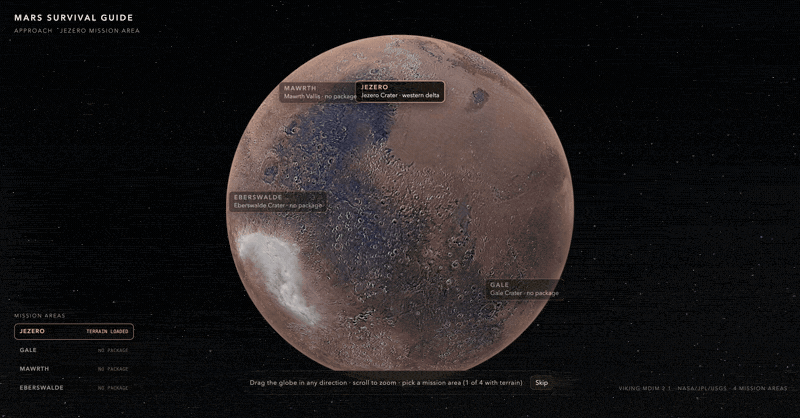
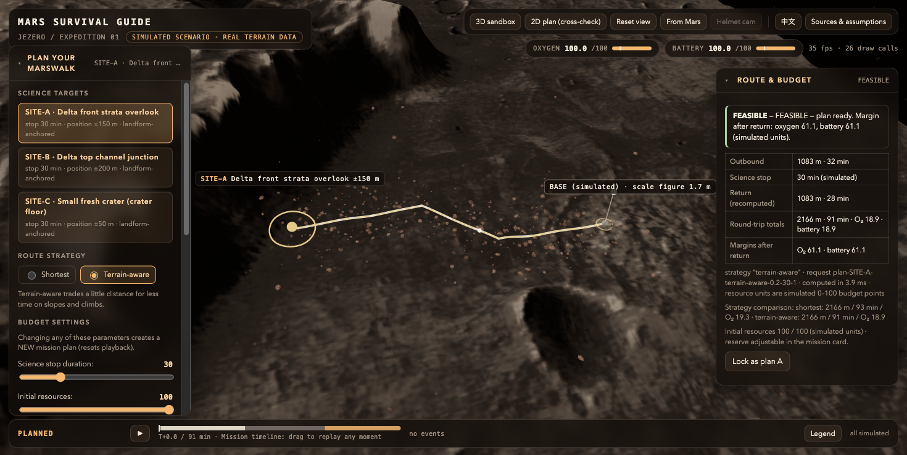
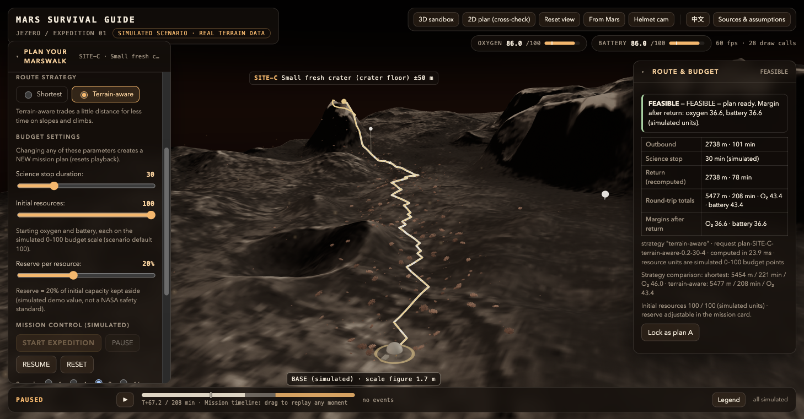
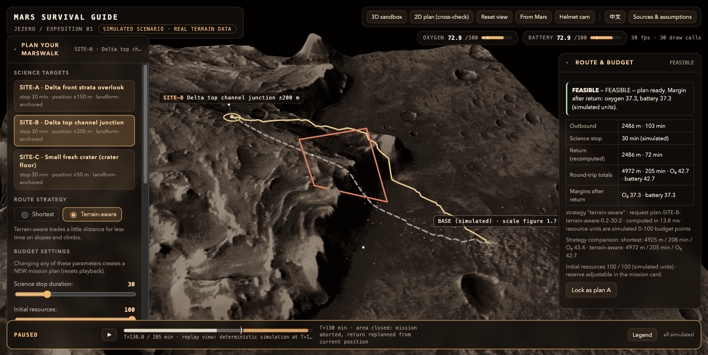
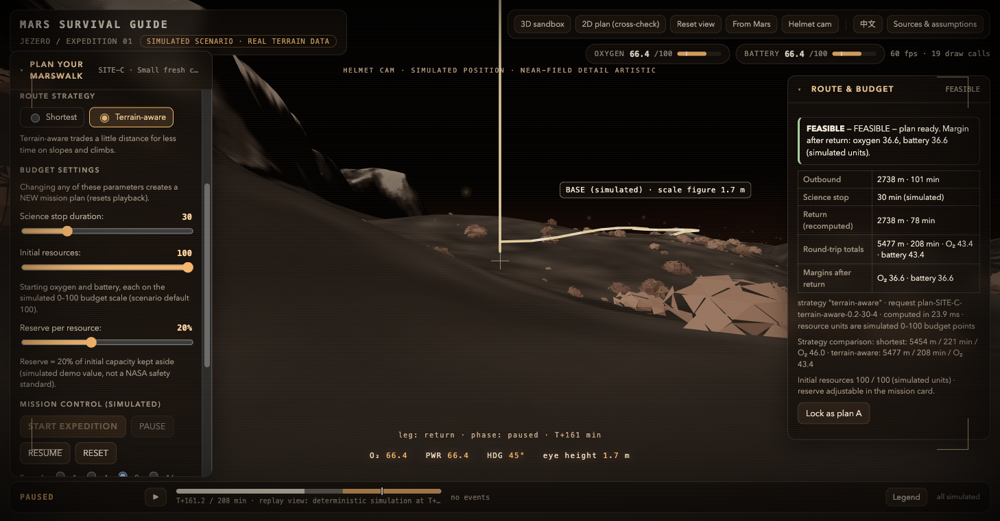
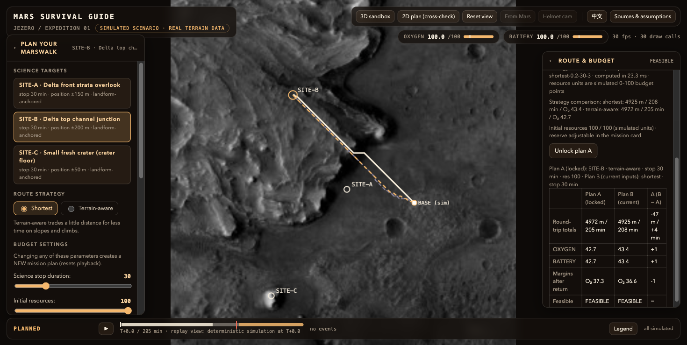

# Mars Survival Guide: Martian Map

[English](README.md) · [简体中文](README.zh-CN.md)

A working Marswalk planning and mission-simulation console built for the **NASA International Space Apps Challenge 2026**, addressing [Interplanetary Survival Guide: Martian Map](https://www.spaceappschallenge.org/2026/challenges/interplanetary-survival-guide-martian-map/).

**[Try the Live Console](https://mars-survival-guide-green.vercel.app/)** · **[GitHub Repository](https://github.com/hexwarrior6/mars-survival-guide)** · **[Submission Details & References](docs/SUBMISSION.md)** · **[3-Minute Demo Script](docs/DEMO.md)**

[](https://youtu.be/ky0IvXPYx0g)

*Click the image above to watch the demonstration video on [YouTube](https://youtu.be/ky0IvXPYx0g).*

---

## Overview

**How far can an astronaut explore across the Martian surface and still return safely to base?**

Mars Survival Guide addresses this question through a focused, science-driven exploration console set in the western delta of **Jezero Crater**. Astronauts depart from a simulated base to investigate scientifically authentic rock strata and crater formations, balance travel time against simulated resource reserves, and respond to sudden traversal incidents such as corridor closures or battery degradation.

This application is an **exploratory planning prototype and educational console**, **not** a video game and **not** an operational astronaut navigation or life-support certification tool. Every element is explicitly categorized as **observed NASA data**, **derived calculation**, **display artwork**, or **simulated assumption**.

---

## Real Application Interface

The screenshots below are captured directly from the running application:

### 1. Planetary Approach & Mission-Area Selection



*Live recording of the intro sequence: the console opens in space, on a Viking MDIM 2.1 colorized global Mars sphere. Drag to rotate, scroll to zoom, and pick one of four documented mission areas (Jezero carries the full terrain package) — the camera then dives continuously from orbit through the 60 km regional context down into the local 3D sandbox.*

### 2. 3D Sandbox Mission Planning



*Full-viewport 3D terrain stage driven by real MRO CTX DEM elevation and ortho imagery, modeled northwest lighting, landform-anchored science destinations (SITE-A/B/C), true 1.7 m scale reference figure, and terrain-hugging outbound/return routes with instantaneous budget evaluation.*

### 3. Low-Angle Terrain Climb (Real DEM Relief)



*The same sandbox seen from ground level: the terrain-aware A\* route hugs the contours of the western delta hillside on its climb to SITE-C (small fresh crater), with the astronaut marker mid-route at T+67 of a 208-minute simulated round trip. Vertical relief is exaggerated ×4.5 for readability, but every twist of the ribbon is a real A\* decision on the 20 m DEM grid.*

### 4. Deterministic Timeline & Emergency Replanning



*Minute-by-minute deterministic replay along the mission timeline. When a simulated traversal incident strikes (e.g. passage closure at T+130 min), the invalidated segment is dashed in gray, a safe detour route is computed in real time, and the amber returnable-range boundary contracts dynamically.*

### 5. Plan A/B Multi-Strategy Comparison


*Lock Plan A to evaluate side-by-side trade-offs against Plan B under altered inputs (e.g. Shortest vs. Terrain-aware routing, variable science-stop durations). Dual route ribbons display simultaneously alongside a delta comparison table.*

### 6. First-Person Helmet Cam



*The return leg (T+161) from the simulated astronaut's 1.7 m eye height, with an active telemetry HUD — remaining O₂/power budget, heading, mission leg and phase — rendered over the same real CTX terrain. Near-field detail is labeled as artistic treatment.*

### 7. 2D Orthophoto Cross-Check & WebGL Fallback



*True top-down orthographic map utilizing the ungraded CTX imagery resampled to 20 m/px from the approximately 5 m/px source mosaic, providing an independent spatial verification view with scale bar and north arrow, as well as a fallback when WebGL is unavailable.*

---

## Key Capabilities

- **Real NASA Terrain Package**:
  - $5.12 \times 5.12\text{ km}$ area of Jezero Crater western delta resampled to a $256 \times 256$ grid at $20\text{ m/px}$, generated deterministically from MRO CTX DEM and orthophoto mosaics.
  - Complete data provenance in `sources.json`, SHA256 checksums, control-point alignment reports, and HiRISE 1 m DTM cross-validation records.
  - Science objectives anchored to documented NASA/JPL Mars 2020 Perseverance exploration goals with explicit $50\text{--}200\text{ m}$ position uncertainty.
- **Deterministic Planning Kernel**:
  - $A^*$ and Dijkstra search over an 8-neighbor graph rejecting impassable cells ($>20^\circ$ slope, NoData, or closed areas) and diagonal corner-cutting.
  - Two distinct pathfinding strategies: **Shortest** (minimal geometric distance) and **Terrain-aware** (penalizes steep terrain and energy-draining ascents).
  - Simulated climb asymmetry: net elevation gain incurs a $+0.3\text{ min/m}$ ascent penalty; the return leg is independently computed from scratch.
- **Resource Budget & Safety Margins**:
  - Outbound walk + on-site science stop + return walk evaluated against abstract $0\text{--}100$ budget units (oxygen and battery).
  - Checks an adjustable reserve threshold (20% by default, a simulation assumption). Over-budget or unreachable destinations are flagged with explicit reason codes.
- **Dynamic Returnable Range**:
  - Reverse-Dijkstra cost field propagating from base across the real elevation grid, continuously mapping the boundary from which the astronaut can safely reach home right now under prevailing resource levels.
- **Scrubbable Mission Timeline**:
  - Mission state at simulated minute $T$ is a pure mathematical function of $T$ (`missionStateAt`).
  - Scrub forward and backward without compounding errors or duplicating events.
  - Four scripted presets: nominal round trip, passage closure with detour, reserve breach, and stranded outcome.
- **Plan A/B Comparison**:
  - Freeze any valid route as Plan A, tweak parameters (destination, strategy, science-stop duration, initial resources), and compare metrics with direct numerical deltas ($\Delta = B - A$).
- **First-Person Helmet Cam**:
  - View the terrain from the simulated astronaut's first-person perspective with active telemetry HUD (heading, oxygen, battery, phase, elevation).
- **Planetary Approach & Context**:
  - Starts from a Viking MDIM 2.1 colorized global Mars sphere and zooms continuously through a 60 km CTX regional context down into the local 3D sandbox.
- **Bilingual Interface**:
  - English by default; toggle instantly to Chinese via the toolbar button or `#CNZH` URL hash.

---

## Data Truth & Simulation Boundaries

To maintain scientific integrity, this project strictly separates empirical NASA observations from engineering models and artistic treatments:

| Category | Elements | Role & Limitations |
| :--- | :--- | :--- |
| **Observed Data** *(NASA)* | • MRO CTX DEM ($20\text{ m/px}$)<br>• MRO CTX Orthophoto ($5\text{ m/px}$)<br>• MRO HiRISE DTM ($1\text{ m/px}$)<br>• Viking MDIM 2.1 Global Mosaic<br>• Mars 2020 Science Objectives | Real scientific observations. CTX DEM sets planning grid elevations; CTX ortho provides 2D/3D map texture; HiRISE serves as an independent cross-check ($\sim 93\text{ m}$ north/south registration offset recorded); Viking mosaic provides global context. |
| **Derived Calculations** *(Deterministic)* | • $256 \times 256$ Elevation & Slope Grids<br>• $A^*$ / Dijkstra Traversal Routes<br>• Asymmetric Climb Travel Times<br>• Reverse-Dijkstra Cost Field<br>• Returnable Range Contours | Computed from DEM and a simplified, simulated movement model. Deterministic and covered by a project suite of 70 automated tests. Not certified for real flight operations. |
| **Display Artwork** *(Labeled Visuals)* | • Cut-away Block Synthetic Strata<br>• Surface Tint & Micro-relief Normals<br>• Mars Globe Albedo Bump Map<br>• Atmosphere, Sky Gradient & Dust Haze<br>• $70\text{ m}$ Selection Ring & Scale Light Pillar | Visual enhancements designed for aesthetic depth and clarity. All such elements are explicitly identified as non-scientific in the legend and sources drawer. Vertical relief exaggerated $\times 4.5$ in 3D. |
| **Simulated Scenarios** *(Assumptions)* | • Jezero Base Facility Location<br>• Suited Walking Pace ($40\text{ m/min}$)<br>• Abstract Budget ($0\text{--}100$ units)<br>• $20\%$ Safety Reserve Margin<br>• Traversal Incidents (Closure, Battery Drop) | Hypothetical operational assumptions established for simulation demonstration. Documented with acceptable parameter ranges in `sources.json`. |

---

## Quickstart & CLI Commands

### Prerequisites
- Node.js (tested with Node 24)
- npm

### Installation & Development

```bash
# Clone the repository
git clone https://github.com/hexwarrior6/mars-survival-guide.git
cd mars-survival-guide

# Install dependencies
npm install

# Start local development server (Vite)
npm run dev
# Open http://localhost:5173 (English) or http://localhost:5173/#CNZH (Chinese)
```

### Verification & Testing Commands

```bash
# Run type checking
npm run typecheck

# Run test suite serially (70 automated tests, performance gate requirement)
npm test -- --no-file-parallelism

# Validate published data packages (verifies schema 1.1 and 14 SHA256 checksums)
npm run validate:data

# Build production bundle
npm run build

# Run CLI route planning demonstration
npm run demo
```

---

## Tech Stack & Architecture

- **Core Framework**: React 19, TypeScript
- **3D Visualization**: Three.js, React Three Fiber (`@react-three/fiber`), Drei (`@react-three/drei`)
- **Build Tool**: Vite 7, Rollup
- **Test Framework**: Vitest (70 unit and integration tests)
- **Algorithms**: Custom deterministic 8-neighbor $A^*$, Dijkstra, and reverse-cost wave expansion
- **Data Preprocessing**: Python, GDAL, NumPy (scripts located in `scripts/data/`)
- **Deployment**: Static zero-backend deployment on Vercel

```text
src/
├── domain/       # Data schemas, package loading, coordinate transforms, assumptions
├── routing/      # 8-neighbor graph, A*/Dijkstra search, budget validator, cost fields
├── simulation/   # Deterministic state machine (missionStateAt), replay runtime, presets
├── data/         # Fetch and Node file system loaders
├── ui/           # React Three Fiber Sandbox, 2D Canvas fallback, HUD, timeline, panels
└── cli/          # Standalone Node demo CLI (npm run demo)
```

---

## Verification & Performance

Validation on the current macOS / Node 24 environment includes type checking, a production build, verification of 14 published data files, and **70 passing tests** across 9 test files.

- Route-planning timings vary by target and environment; recorded local kernel runs complete well within the 1-second interaction target. Historical browser measurements are documented in [acceptance records](docs/IMPLEMENTATION.md).
- The returnable-range test enforces a 50 ms local performance gate. Run tests serially: concurrent load can exceed that threshold.
- Rendering performance depends on the device, view and effects. A stall watchdog and adaptive bloom fallback support slower environments; no universal frame-rate guarantee is made.

---

## Limitations & Scope

- **Prototype Disclaimer**: This is an educational and research prototype. It does not provide certified astronaut navigation or life-support telemetry.
- **Grid Resolution**: The $20\text{ m}$ DEM grid cannot resolve sub-pixel hazards, crevasses, or small boulders.
- **Site Uncertainty**: Science targets are landform anchors with documented $50\text{--}200\text{ m}$ spatial uncertainty.
- **Inter-Mission Registration**: An approximate $93\text{ m}$ north-south registration discrepancy exists between the HiRISE DTM and CTX DEM products in the alignment cross-check; its cause has not been established here.
- **Documented Extensions**: Multi-target itineraries, MEDA environmental weather history, ionizing radiation prediction, and runtime LLM agents are documented future extensions (`docs/IMPLEMENTATION.md` §8) and are not implemented.

---

## Project Documentation Index

- [docs/SUBMISSION.md](docs/SUBMISSION.md) — Formal project description, NASA dataset references, and AI disclosure
- [docs/DEMO.md](docs/DEMO.md) — A 3-minute repeatable demonstration script
- [docs/README.md](docs/README.md) — Implementation and phase documentation guide (Chinese)
- [docs/SPECIFICATION.md](docs/SPECIFICATION.md) — Engineering requirements, algorithmic contracts, and interfaces
- [docs/RESEARCH.md](docs/RESEARCH.md) — Competition requirements, dataset evaluation, and evidence boundaries
- [docs/IMPLEMENTATION.md](docs/IMPLEMENTATION.md) — Implementation milestones and acceptance records
- [docs/VISUAL-DIRECTION.md](docs/VISUAL-DIRECTION.md) — Visual principles and art/science separation boundaries
- [docs/VISUAL-UPGRADE-PLAN.md](docs/VISUAL-UPGRADE-PLAN.md) — 3D sandbox aesthetic enhancement records

---

## Attribution, Submission History & License

- **Team**: **Liang-Tzu**, Singapore Local Event.
- **Competition Submission Record**:
  - The project was officially submitted for judging on 2026-11-15 at 23:49 Singapore time (confirmed by the Space Apps portal, with final hyperlink update recorded at 23:52).
  - The historical submitted demonstration video was approximately 35 seconds ([Watch historical video](https://youtu.be/41C24oOkQJE)).
- **Repository Demonstration**:
  - As of 2026-11-16, an updated demonstration video ([Watch latest video](https://youtu.be/ky0IvXPYx0g)) is featured for repository visitors. This updated showcase is distinct from the formal judging submission record; no official acceptance or eligibility status is claimed.
- **AI Tool Disclosure**:
  - AI tools (Codex, Antigravity) were employed for research assistance, implementation planning, code scaffolding, automated testing, and documentation formatting.
  - The application contains **no runtime LLM**; all pathfinding, budgeting, and simulation logic are deterministic TypeScript calculations. Full disclosure is available in [docs/SUBMISSION.md](docs/SUBMISSION.md).
- **License**:
  - Code is licensed under the [MIT License](LICENSE).
  - External NASA datasets, HiRISE/CTX imagery, and Viking mosaics remain under their respective public domain and academic citation terms. See `public/data/jezero/sources.json` and `public/data/mars/README.md`.
