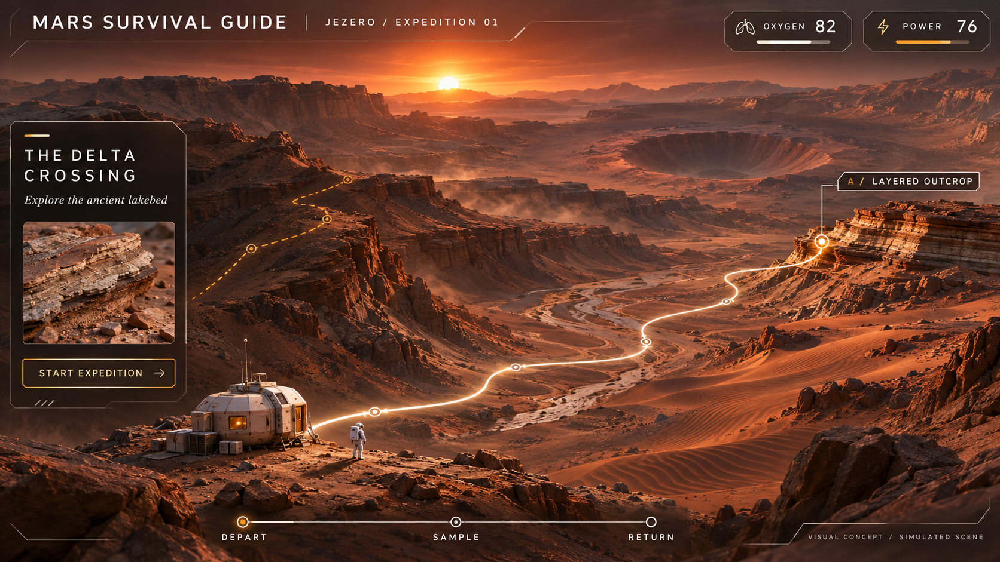

# Mars Survival Guide: Martian Map

A planned Marswalk planning and simulation console for the **NASA International Space Apps Challenge 2026**, addressing [Interplanetary Survival Guide: Martian Map](https://www.spaceappschallenge.org/2026/challenges/interplanetary-survival-guide-martian-map/).

**Status: planning only.** This repository contains implementation specifications, not a working application. No live demo is available yet.

## Design preview

**AI-generated visual concept:** cinematic terrain, fictional locations, and example values. This is an art-direction target, not a working 3D scene, an animation, or NASA imagery. See the [visual direction](docs/VISUAL-DIRECTION.md) for interaction and implementation boundaries.

[View all five stage previews](docs/README.md) · [Implementation and acceptance criteria](docs/IMPLEMENTATION.md)

## Purpose

Help users plan a science excursion in a small area of Jezero Crater, inspect terrain and science destinations, estimate a round trip within a resource budget, and replan a return route when a simulated incident changes the mission.

This is a research and educational prototype. Routes and resource estimates will use documented, simplified assumptions; they are not validated astronaut navigation or life-support guidance.

## Planned experience

1. Explore a local map with terrain, imagery, and evidence-backed science destinations.
2. Select a simulated base and a science target; inspect outbound and return routes, duration, oxygen, and battery estimates.
3. Run a repeatable simulation and trigger battery loss or a blocked area.
4. Review an updated return route, or an explicit explanation that no feasible return was found under the model.
5. Inspect the sources, processing methods, and assumptions behind the information.

The visual priority is an immersive 3D terrain sandbox with cinematic camera transitions, terrain-following routes, and visible incident responses. Additional science waypoints, atmospheric models, and an optional AI explanation assistant remain later enhancements. Advanced features follow the core acceptance gates; they are not implemented today.

## Data approach

Candidate sources include MRO terrain and orbital imagery, Perseverance surface imagery and science records, and [MEDA observations in NASA PDS](https://pds-atmospheres.nmsu.edu/data_and_services/atmospheres_data/PERSEVERANCE/meda.html). Product selection, download, parsing, and alignment remain to be validated.

Layers will distinguish **observations**, **derived results**, and **simulation assumptions**. Historical rover readings will not be presented as live weather or measurements at every map location. Curiosity RAD data will not be presented as an observed Jezero radiation map. Mineral claims require location-specific supporting records.

## Implementation plan

Start with the [documentation index](docs/README.md) (Chinese):

- [Research and source limitations](docs/RESEARCH.md)
- [Product and engineering contracts](docs/SPECIFICATION.md)
- [Phased implementation and acceptance gates](docs/IMPLEMENTATION.md)

The planned stack is TypeScript, React, and Vite, with a WebGL terrain view, HTML/SVG controls, preprocessed static data, and deterministic routing. Rendering-library selection and a 2D fallback will be validated during the visual implementation stage. The core workflow needs no application backend. Package versions and setup commands will be documented when implementation starts; there is no runnable quick start yet.

## Attribution and participation

The original concept names **Liang-Tzu**, Singapore Local Event. Account membership and submission status have not been verified. AI development assistance and dataset attribution must be documented in the eventual submission.

Code is licensed under [MIT](LICENSE). External datasets and imagery retain their own terms and attribution requirements; the repository license does not relicense them.
