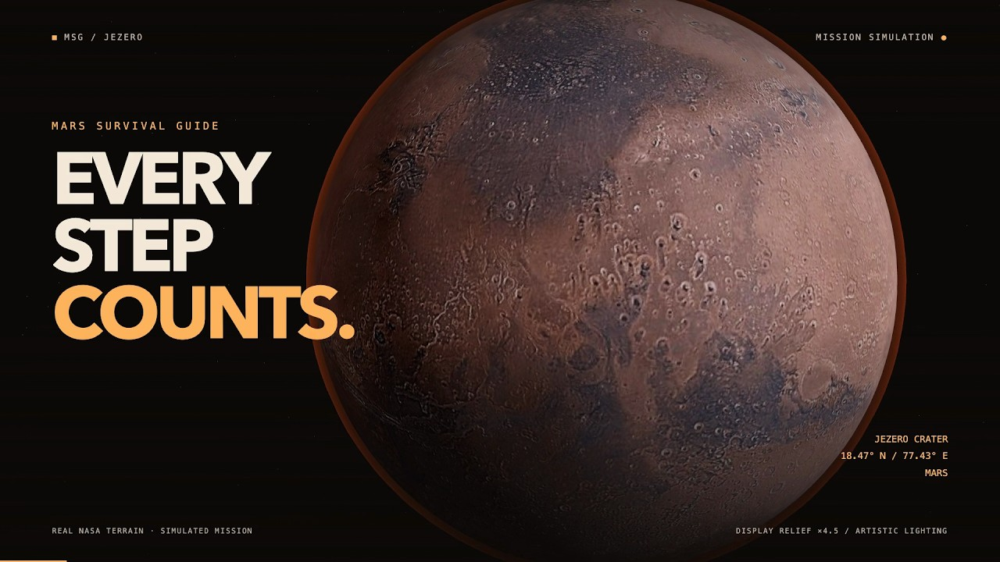
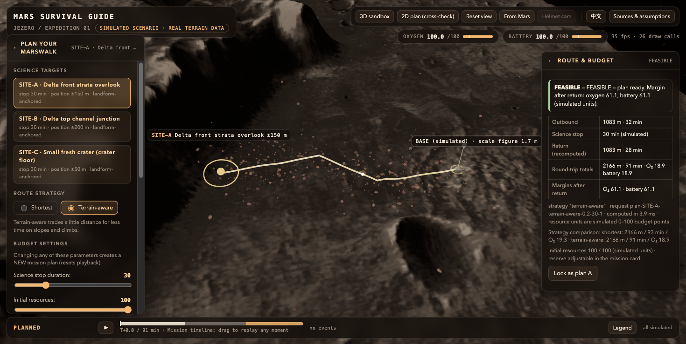
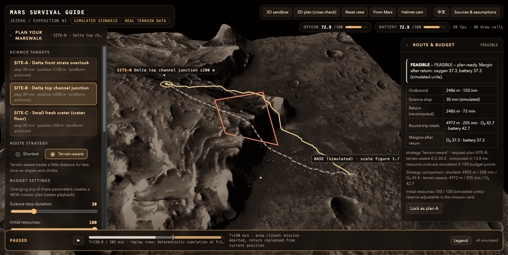
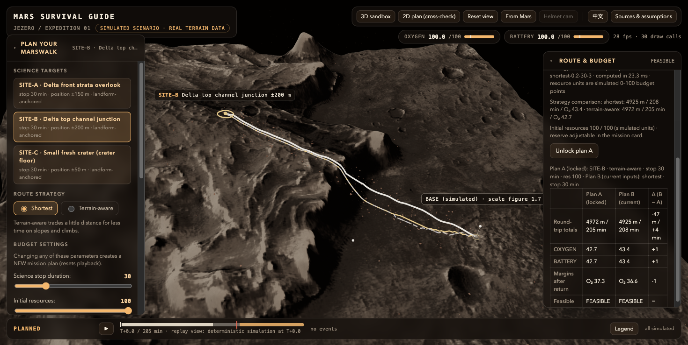
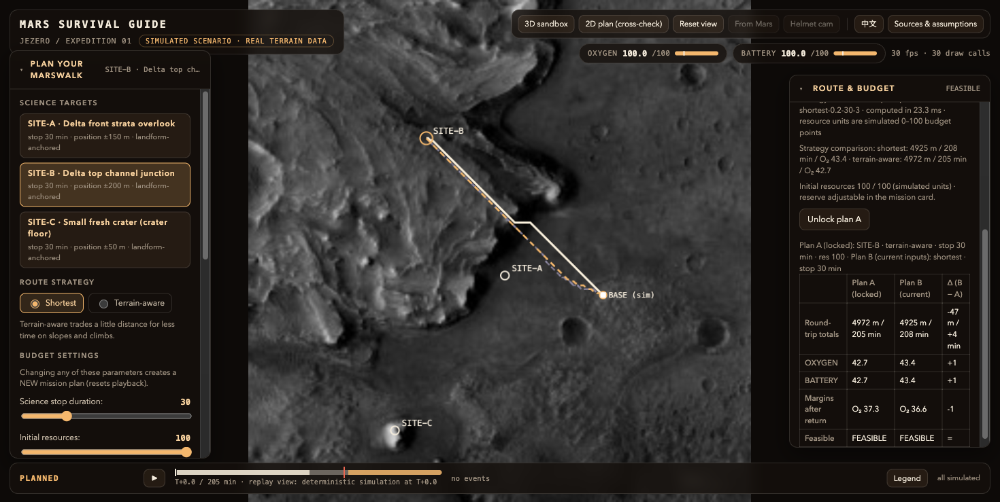

# 火星生存指南：火星地图（Mars Survival Guide）

[English](README.md) · [简体中文](README.zh-CN.md)

为 **NASA International Space Apps Challenge 2026** 竞赛题目 [Interplanetary Survival Guide: Martian Map](https://www.spaceappschallenge.org/2026/challenges/interplanetary-survival-guide-martian-map/) 设计并实现的火星出舱漫步规划与任务模拟控制台。

**[在线体验控制台](https://mars-survival-guide-green.vercel.app/)** · **[GitHub 仓库](https://github.com/hexwarrior6/mars-survival-guide)** · **[提交说明与数据引用](docs/SUBMISSION.md)** · **[3分钟演示流程](docs/DEMO.md)**

[](https://youtu.be/ky0IvXPYx0g)
*点击上方图片在 [YouTube](https://youtu.be/ky0IvXPYx0g) 观看最新演示视频。*

---

## 项目概述

**宇航员在火星表面最远能探索多远，且能确保安全返回基地？**

Mars Survival Guide 围绕这一核心决策问题，在火星 **Jezero 陨石坑** 西部三角洲建立了科学驱动的交互式任务规划沙盘。宇航员从模拟基地出发，前往有地质资料支持的陆标锚定目标进行模拟科学考察，在可调的模拟资源预留约束下权衡行进时间与生命支持消耗，并在通道封闭或电池骤降等突发意外时快速重新规划应急返航路线。

本项目是一套**研究与教育探索原型控制台**，**不是游戏**，也**不是用于实际载人飞行的运行时导航或生命保障认证系统**。系统中每一项元素均严格区分为 **NASA 真实观测数据**、**确定性衍生计算**、**显示层视觉美术** 与 **模拟场景假设**。

---

## 真实应用界面

以下截图均采集自正在运行的真实桌面应用：

### 1. 3D 沙盘任务规划

*全视口 3D 地形舞台，由真实 MRO CTX DEM 高程网格与正射影像驱动，采用与 DEM 阴影方向一致的模拟西北向光照。标注陆标锚定的科学考察点（SITE-A/B/C）与 1.7 米真人比例参照物，贴地渲染去程与返程路线，并实时输出资源可行性判定与预算指标。*

### 2. 确定性时间轴与应急返航

*按任务分钟逐分精确推演的确定性时间轴。当模拟突发事件触发时（如 T+130 分钟中央断崖通道封闭），原失效路线转为灰色虚线，系统实时重算出绕行避障的应急返航路线（琥珀色实线），底部时间轴显示事件标记，琥珀色可返航范围边界同步动态收缩。*

### 3. 方案 A/B 多策略对比

*锁定当前方案为方案 A，修改输入条件（如切换最短距离与地形感知策略、调整采样停留时间）即生成方案 B。沙盘同屏渲染双路线（虚线 vs 实线），右侧面板展开距离、耗时、氧气、电量与返航余量的逐项差值对比表（$\Delta = B - A$）。*

### 4. 2D 正射影像核对与 WebGL 降级

*基于未经调色、由约 5 米/像素 CTX 源影像重采样至 20 米/像素的正射图构建的正南正北平面核对视图。提供真实比例尺与指北针，既作为科学空间位置的独立核验界面，也在 WebGL 不可用或遇到异常时作为2D 降级视图自动启用。*

---

## 核心功能

- **真实 NASA 地形与科学数据包**：
  - 基于 MRO CTX DEM 与正射影像镶嵌体，生成覆盖 Jezero 三角洲前缘 $5.12 \times 5.12\text{ km}$ 区域、分辨率为 $20\text{ 米/格}$ 的 $256 \times 256$ 规划网格（数据架构版本 1.1，内置于 `public/data/jezero/`）。
  - 附带完整数据凭证：`sources.json` 记录 6 项源数据产品标识与检索许可、全量发布文件的 SHA256 校验和、正射影像与 DEM 控制点对齐精度报告，以及 HiRISE 1 米 DTM 的独立交叉验证记录。
  - 科学考察点锚定于真实沉积陆标，附带 NASA/JPL Mars 2020 毅力号任务科学目标与 $50\text{--}200\text{ 米}$ 空间不确定度。
- **确定性路径规划内核**：
  - 基于 8 邻域图结构运行 $A^*$ 与 Dijkstra 算法，严格排除坡度超标格（$>20^\circ$，已标注的模拟阈值）、NoData 缺失格与阻断区域，禁止斜角穿墙。
  - 提供两种路径策略：**最短几何距离（Shortest）** 与 **地形感知（Terrain-aware）**（对陡坡与爬升施加加权惩罚）。
  - 模拟爬坡方向对耗时的影响：净爬升每米增加 $+0.3\text{ 分钟}$ 耗时；返程路线始终独立重新规划，绝非去程路线的简单反向倒放。
- **资源预算与安全底线**：
  - 综合计算去程步行、科学采样停留、返程步行与可调的资源预留比例（默认 $20\%$，属于模拟假设）（按抽象 $0\text{--}100$ 点数计量氧气与电池）。
  - 明确输出可行（`feasible`）、超预算（`over_budget`）、不可达（`unreachable`）与无效输入状态，超预算提示明确限定为“在所搜索策略下未找到满足预算的候选方案”。
- **动态可返航范围（Returnable Range）**：
  - 从基地出发运行反向 Dijkstra 代价场，沿真实地表逆向计算各点回基地的最小耗时。
  - 在 3D 与 2D 地图上实时投射动态收缩的等值线边界，精确反映“以宇航员当前的剩余资源，还能从哪些地表位置安全走回基地”。
- **可拖动回看任务时间轴**：
  - 任务在模拟第 $T$ 分钟的状态是 $T$ 的纯数学函数（`missionStateAt`），无需储存冗余历史状态即可任意跳转。
  - 拖拽底部时间轴可回放到任意时刻，前后拖动不会重复施加事故惩罚；预设 4 组确定性场景（名义往返、采样中封路绕行、电池预留击穿、电池滞留无法返航）。
- **方案 A/B 冻结对比**：
  - 支持将任意可行计划锁定为方案 A，调整参数后与方案 B 同屏并排对比双路线及详细差值表。
- **第一人称宇航员头盔视角（Helmet Cam）**：
  - 从模拟宇航员的第一人称视角沿规划路线行进，配备宇航服 HUD 抬头显示（方位角、氧气、电量、阶段、T+时钟、视高）。
- **行星级尺度连续接近**：
  - 从 Viking MDIM 2.1 火星彩色真实全局球体出发，无缝对准 Jezero 坐标并以对数相机轨迹贯通 60 公里 CTX 区域图，平滑过渡至局部 3D 任务沙盘。
- **完善的中英双语界面**：
  - 默认英文界面，工具栏或 URL 尾缀 `#CNZH` 一键切换中文。

---

## 科学事实与模拟边界

为了保证严谨性，项目严格界定真实观测数据、数学计算、视觉表现与模拟设定的边界：

| 类别 | 包含元素 | 作用与事实边界 |
| :--- | :--- | :--- |
| **真实观测数据** *(NASA)* | • MRO CTX DEM ($20\text{ m/px}$)<br>• MRO CTX 正射影像 ($5\text{ m/px}$)<br>• MRO HiRISE DTM ($1\text{ m/px}$)<br>• Viking MDIM 2.1 全球彩色图<br>• Mars 2020 科学目标记录 | 真实的 NASA 科学探测资产。CTX DEM 提供规划高程；CTX 正射影像提供地表纹理；HiRISE 仅作独立高程校验（记录了约 $93\text{ 米}$ 的南北配准偏差）；Viking 提供行星开场背景。数据预打包随应用离线交付，运行时不依赖外部 API。 |
| **确定性衍生计算** *(数学算法)* | • $256 \times 256$ 高程与坡度网格<br>• $A^*$ / Dijkstra 往返路线<br>• 爬升不对称步行耗时<br>• 反向 Dijkstra 成本场<br>• 可返航范围边界等值线 | 依据 DEM 高程与简化的模拟运动模型派生。算法纯函数化，通过 70 项自动化单测守护。计算结果具有确定性，但未作飞行任务级安全认证。 |
| **显示层视觉美术** *(明确标注)* | • 剖切块体人工层理侧壁<br>• 增强对比微观法线与色调映射<br>• 火星全局球微观起伏法线<br>• 大气晕光、低空雾与尘埃微粒<br>• $70\text{ 米}$ 选中环与位置光柱 | 为提升沙盘立体感和可读性而增加的纯视觉表现，垂直起伏在 3D 下夸大 $\times 4.5$ 倍展示。在图例与数据抽屉中均明确标注为“显示美术（非测量结果）”。2D 平面核对视图保持原始影像不变。 |
| **模拟场景设定** *(假设参数)* | • Jezero 模拟基地位置<br>• 宇航服平地步行速度 ($40\text{ 米/分}$)<br>• 抽象预算点数 ($0\text{--}100$ 单位)<br>• $20\%$ 强制安全预留比例<br>• 突发意外（断崖封闭、电池跌落） | 为完成任务模拟演示而设定的工程假设。参数在 `sources.json` 中公开注册并标明合理取值区间，用户可在界面中调整。 |

---

## 快速上手与验证命令

### 环境准备
- Node.js（已在 Node 24 测试）
- npm

### 安装与启动

```bash
# 克隆仓库
git clone https://github.com/hexwarrior6/mars-survival-guide.git
cd mars-survival-guide

# 安装依赖
npm install

# 启动本地开发服务器
npm run dev
# 浏览器访问 http://localhost:5173 （英文）或 http://localhost:5173/#CNZH （中文）
```

### 验证与质量检查

```bash
# TypeScript 类型检查
npm run typecheck

# 运行自动化测试套件（串行执行，满足性能门槛要求，共 70 项测试）
npm test -- --no-file-parallelism

# 校验发布数据包（核对 schema 1.1 及 14 个文件的 SHA256 校验和）
npm run validate:data

# 生产环境打包构建
npm run build

# 运行命令行路线规划演练
npm run demo
```

---

## 技术架构与工程实现

- **前端框架**：React 19、TypeScript
- **3D 渲染**：Three.js、React Three Fiber (`@react-three/fiber`)、Drei (`@react-three/drei`)
- **构建工具**：Vite 7、Rollup
- **测试框架**：Vitest（70 项单元与集成测试）
- **算法实现**：原生 TypeScript 8 邻域图构建、$A^*$ / Dijkstra 寻路、反向波前展开
- **数据管线**：Python、GDAL、NumPy 离线预处理（脚本位于 `scripts/data/`）
- **部署方式**：Vercel 静态页面部署，无需任何后端数据库或运行时服务

```text
src/
├── domain/       # 数据结构、数据包加载校验、坐标变换与模拟假设
├── routing/      # 8 邻域图、A*/Dijkstra 寻路、预算检验、反向成本场
├── simulation/   # 确定性状态机（missionStateAt）、时间轴回放运行时、预设场景
├── data/         # 浏览器 fetch 与 Node 本地文件系统加载适配器
├── ui/           # React Three Fiber 3D 沙盘、2D Canvas 降级视图、HUD、时间轴、控制面板
└── cli/          # 命令行路线规划测试入口（npm run demo）
```

---

## 实测性能与指标

当前 macOS / Node 24 环境已通过类型检查、生产构建、14 个发布数据文件校验，以及 9 个测试文件中的 **70 项测试**。

- 路线计算耗时随目标和环境变化；已有本地内核实测远低于 1 秒交互目标。历史浏览器测量见[验收记录](docs/IMPLEMENTATION.md)。
- 可返航范围测试采用本地 50 毫秒性能门槛。请串行运行测试；并行负载可能使该门槛超时。
- 渲染速度取决于设备、视角和效果。项目提供帧停滞监控与泛光自动降级，不承诺所有设备维持固定帧率。

---

## 必要限制与说明

- **非飞行认证软件**：本项目为探索与教育原型，不构成真实的航天员舱外导航或生命安全决策支持。
- **网格分辨率限制**：$20\text{ 米}$ 采样格无法分辨亚像元级别的碎石、微裂缝与局部微地形危险。
- **考察点定位误差**：科学目标锚定于宏观地貌，标称位置存在 $50\text{--}200\text{ 米}$ 不确定度。
- **数据配准偏差**：HiRISE DTM 与 CTX DEM 交叉核对时记录了约 $93\text{ 米}$ 的南北配准偏差；本项目尚未确定其原因。
- **未实现的后续扩展**：多目标规划、MEDA 历史气象数据融合、空间电离辐射模型与运行时 AI 解释助手属于未来扩展方向（记录于 `docs/IMPLEMENTATION.md` 第 8 节），本参赛版本不包含。

---

## 详细文档索引

- [docs/SUBMISSION.md](docs/SUBMISSION.md) — 英文项目说明、NASA 数据来源、详细引用与 AI 使用披露
- [docs/DEMO.md](docs/DEMO.md) — 约 3 分钟可重复的评审演示操作流程
- [docs/README.md](docs/README.md) — 实施阶段与历史文档入口
- [docs/SPECIFICATION.md](docs/SPECIFICATION.md) — 产品与工程设计约定、接口规范与计算规则
- [docs/RESEARCH.md](docs/RESEARCH.md) — 比赛要求核查、数据候选评估与证据边界
- [docs/IMPLEMENTATION.md](docs/IMPLEMENTATION.md) — 各阶段实施记录与逐项验收证据
- [docs/VISUAL-DIRECTION.md](docs/VISUAL-DIRECTION.md) — 沙盘视觉设计方向与艺术/科学边界
- [docs/VISUAL-UPGRADE-PLAN.md](docs/VISUAL-UPGRADE-PLAN.md) — 3D 沙盘视觉升级方案与实施记录

---

## 团队、比赛提交记录、许可证与 AI 披露

- **参赛团队**：**Liang-Tzu**，新加坡分赛区（Singapore Local Event）。
- **比赛正式提交记录**：
  - 本项目于 2026-11-15 23:49（新加坡时间）通过 NASA Space Apps 比赛平台正式确认提交评审（网站显示“Project Submitted for Judging”，并在超链接更新后于 23:52 完成最后确认提交）。
  - 历史提交的演示视频时长约为 35 秒（[查看历史提交视频](https://youtu.be/41C24oOkQJE)）。
- **仓库展示视频**：
  - 截至 2026-11-16，本仓库展示已更新为最新制作的演示视频（[查看最新演示视频](https://youtu.be/ky0IvXPYx0g)）。本展示更新与当晚的历史正式提交记录明确区分，不将新视频表述为已获比赛官方接收，亦不对评审资格进行臆测。
- **AI 工具使用披露**：
  - 开发流程中使用了 AI 编程助手（Codex、Antigravity）协助进行技术调研、方案起草、代码编写、自动化测试构建与文档整理。
  - 本产品**不包含任何运行时大语言模型（LLM）**；所有路线搜索、预算判据与模拟回放均为纯 TypeScript 编写的确定性算法。完整披露详见 [docs/SUBMISSION.md](docs/SUBMISSION.md)。
- **开源许可证**：
  - 项目代码采用 [MIT 许可证](LICENSE) 开源。
  - 项目引用的 NASA / MRO / HiRISE / CTX / Viking 等外部数据集与影像保留原始版权与公共领域/学术引用条款。详见 `public/data/jezero/sources.json` 与 `public/data/mars/README.md`。
