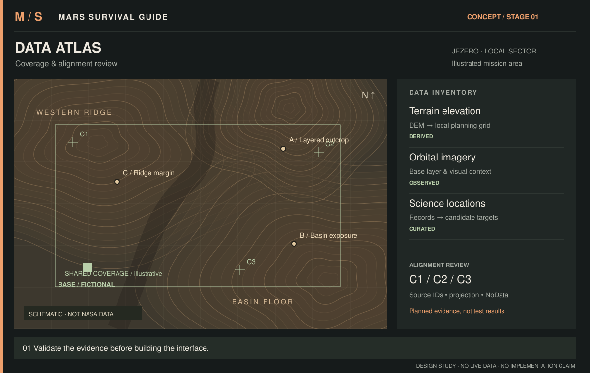
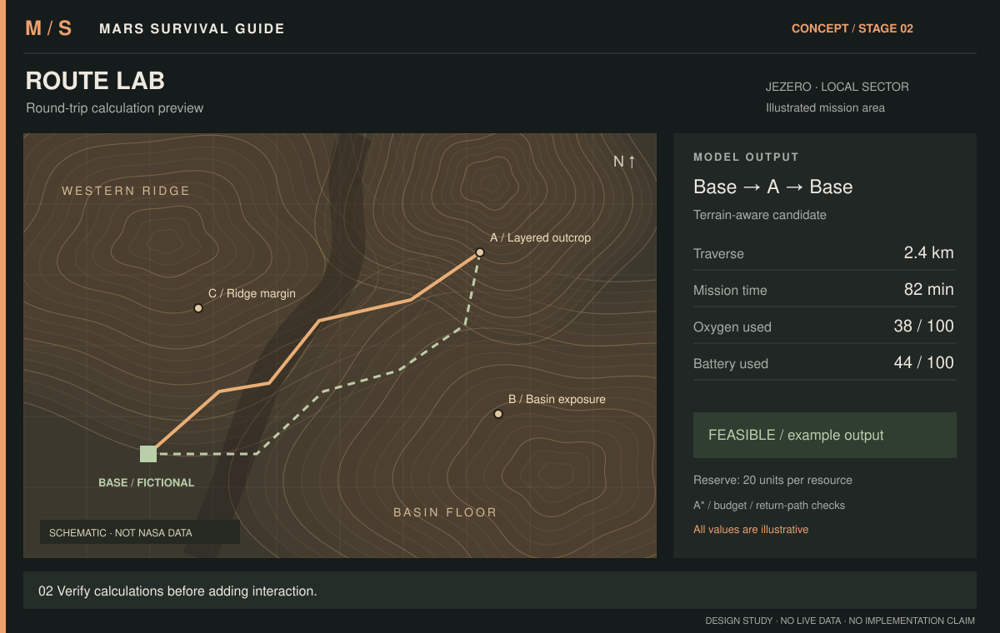
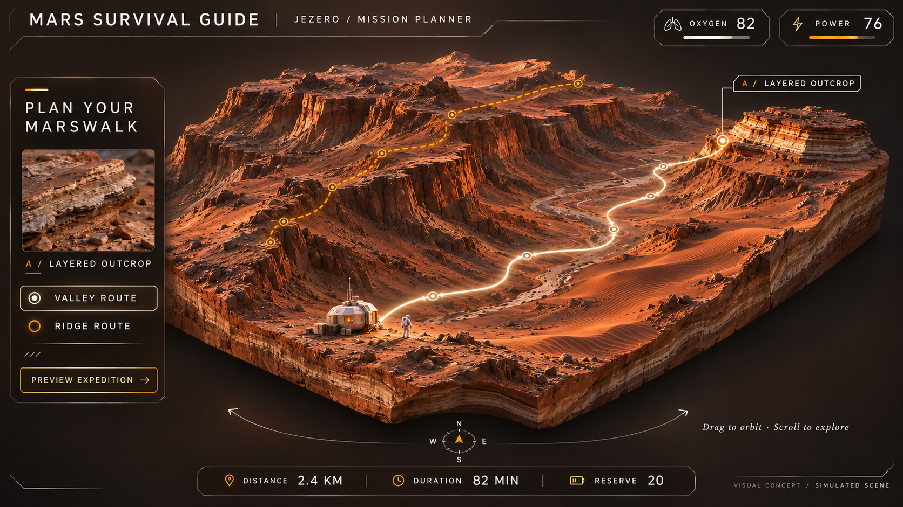
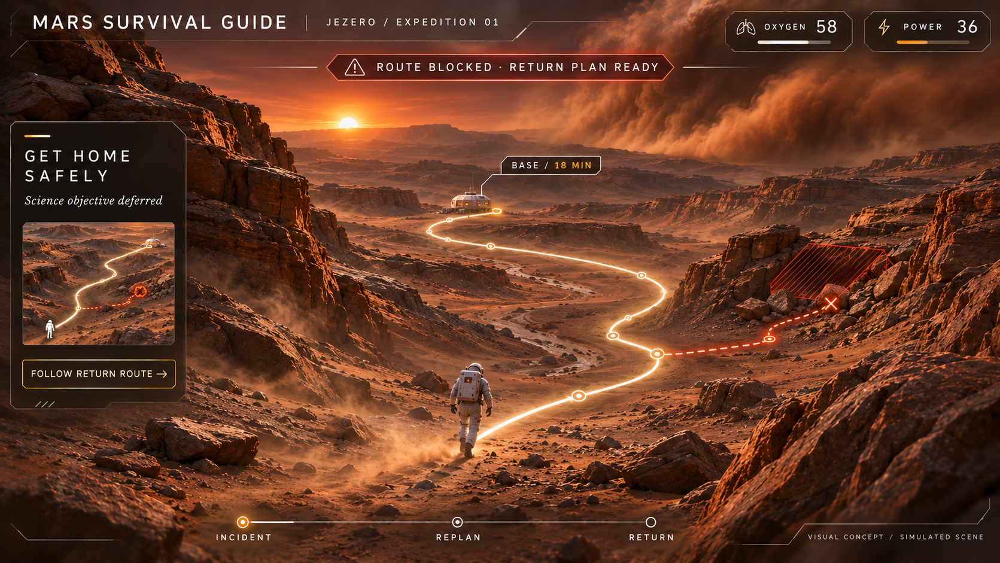
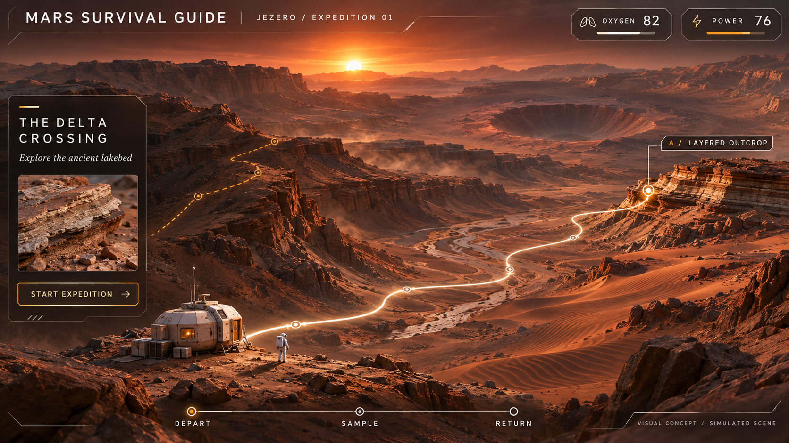

# 分阶段实施与验收

基线日期：2026-11-14。依据：[产品与工程约定](SPECIFICATION.md)、[调研](RESEARCH.md)。**2026-11-14 更新：阶段 1 已执行并完成技术验证（真实数据取得、对齐检查、场景冻结），状态置为待验收；阶段 2–5 未开工。** 最新的视觉与动效目标见 [视觉方向](VISUAL-DIRECTION.md)。

## 1. 阶段总表

| 阶段 | 用户最终看到什么 | 依赖 | 状态 |
| --- | --- | --- | --- |
| 1 数据与场景 | 可核对的真实地图裁剪、科学地点与数据说明 | 无 | 已验收（2026-11-14 用户确认） |
| 2 路线与预算 | 给定目标后返回可解释、可测试的往返计算结果 | 阶段 1 已验收 | **待验收** |
| 3 规划控制台 | 可操作地图、选点、查看路线与资源预算 | 阶段 2 已验收 | **待验收** |
| 4 模拟与应急 | 正常任务与事件触发后的返航闭环 | 阶段 3 已验收 | **待验收** |
| 5 参赛交付 | 可公开体验的版本、演示材料与准确说明 | 阶段 4 已验收 | 未开始 |
| 扩展 | 更完整的原始愿景 | 核心稳定后单独安排 | 未开始 |

按依赖与验收推进，不按“每天完成什么”承诺。每阶段先做最小可验证结果；不要等全部功能写完才检查真实数据能否使用。

## 2. 阶段 1：数据可用性与任务场景

设计示意：图中地形、地点和数值均非真实观测或验收结果。

**目标：** 让真实地形、科学目标和演示区域能够共同成立。此阶段允许数据处理与验证脚本，不开发产品界面。

**执行顺序：**

1. 检查工作区、已有运行环境和数据处理能力。读取源产品标签，优先验证 HiRISE；不可得时验证 CTX 备选。
2. 先用最小样本验证下载、解码、单位、投影、NoData，再决定裁剪区域；不要一开始下载整个火星档案。
3. 取得共同覆盖的地形、底图及至少 3 个科学地点资料。优先以一个有资料的地质观察/采样目标定义故事，再选择邻近点位。
4. 生成可发布的小型数据包、source manifest 和转换脚本；按 SPECIFICATION 冻结坐标、格网和精度。
5. 提供平面叠加检查图与控制点误差；选择模拟基地和事件位置，检查基本连通性。保留正常完成与可替代返航路线的场景，不篡改真实地形来制造戏剧性。

**交付：** 数据处理脚本、裁剪数据、来源与限制记录、场景定义；在调研文档中把实际取得产品与仍是候选的入口区分开。数值宇航服参数留给阶段 2，不伪装成科学数据。

**验收：**

- [ ] D1：至少一个数值 DEM 实际下载、解析成功；源 ID、日期、校验和、单位、投影和分辨率可追溯。
- [ ] D2：MRO 与 Mars 2020 两个任务的资料在同一区域有实际用途；至少 3 个科学地点有目标解释和来源，无法精确定位时显示不确定性。
- [ ] D3：影像、地形、点位至少 3 个控制点对齐；误差符合工程约定，未知区域不会变成 0 高程可通行区。
- [ ] D4：原始输入到发布资产的处理可复现；来源使用条款已检查，observed/derived/simulated 分类齐全。
- [ ] D5：区域、基地、初始网格和两类事件的空间定义冻结；存在正常往返与至少一种事件下的绕行候选。

**受阻处理：** 无真实 DEM 则停止依赖地形的开发；提交取得失败的证据及备选方案。HiRISE → CTX 可按既定备选执行并更新尺度；更换整个区域或放弃地形规划属于范围变化，需说明后再安排。

## 3. 阶段 2：路线与资源计算内核

设计示意：图中地形、地点和数值均非真实观测或验收结果。

**目标：** 不依赖漂亮界面，先证明往返规划和预算可信、可重复。

**工作：** 建立 TypeScript/Vite 最小工程、锁文件和验证脚本；实现数据加载校验、图构建、A*、两种策略、去返程指标、停留耗用与资源预留。集中定义速度、消耗率、坡度阈值等假设及合理输入范围。展示结果可先用简单开发页面或命令行。

**交付：** 独立计算模块、类型契约、测试 fixtures、参数说明、真实数据示例输出。合成 fixtures 只用于测试，不充当科学数据。

**验收：**

- [ ] R1：平面小网格路径长度可手算；A* 与 Dijkstra 在相同代价下得到相同最小代价值。
- [ ] R2：无路径、越界起终点、NoData、过陡格与斜角穿障碍均正确拒绝；不返回直线伪路径。
- [ ] R3：单调增大距离/停留时间不会减少对应资源消耗；检查零值、负值、NaN 和超范围输入。
- [ ] R4：去程、停留、返程全部计入；恰好满足预留与刚好不足的边界结果正确；返程独立计算。
- [ ] R5：真实区域至少一个可行任务、一个超预算任务、一个不可达目标，均有清楚原因；失败表述不超出有限候选搜索能力。
- [ ] R6：类型检查、数据校验、单测与构建实际通过；记录执行命令，不只说“应当通过”。

**边界：** 不实现 LLM 路线生成、不引入后端，不把无约束 A* 包装成多资源全局最优。算法问题未解决前不进入复杂 UI。

## 4. 阶段 3：地图与任务规划控制台

设计示意：图中地形、地点和数值均非真实观测或验收结果。

**目标：** 用户无需读代码即可选择目标、理解路线、核对来源。

**工作：** 先做可旋转地形的渲染与性能验证，再创建视觉主题与统一组件；呈现立体峡谷、光影、基地/人物比例参照、贴地路线和科学点，保留二维核对视图；实现缩放、平移、选择、图层切换、策略选择、预算设置、路线计算、来源抽屉。去程与返程明确区分，比例尺、单位、图例和模拟标识可见。

**交付：** 本地可运行控制台、实际运行命令、真实界面截图或可复查记录。此时允许没有任务播放，但不能出现假装可用的按钮。

**验收：**

- [ ] U1：首次打开能加载固定场景并选中任一科学点；切换图层不改变点位和路线的地理位置。
- [ ] U2：选择目标并计算往返路线，界面数值与阶段 2 输出一致；切换策略后差异可解释。
- [ ] U3：修改预算/目标后旧结果不被当成新计划；加载失败、超预算、不可达有独立状态。
- [ ] U4：来源可追到产品或资料，数据类型/日期/假设可查看；模拟基地与 HUD 不被误认成观测。
- [ ] U5：桌面 1440×900 与窄屏 390×844 检查主要流程；关键控件键盘可达、文本可读，警告不只靠颜色。
- [ ] U6：用真实资产测量加载体积和计算耗时，记录环境；构建后资产路径正常，无核心控制台错误。

- [ ] U7：沙盘可旋转、缩放、复位，选点镜头过渡与贴地路径坐标一致；减少动画模式和二维回退可用，目标机器交互帧率达到视觉约定。

**边界：** 此阶段不把静态生成图或数字动画当作三维交互或后续模拟实现。概念稿中的电影级材质可分级实现，但不能为视觉效果扭曲科学点坐标。

## 5. 阶段 4：任务执行与应急返航

设计示意：图中地形、地点和数值均非真实观测或验收结果。

**目标：** 把“计划—执行—事件—返航—结果”连成一个可重复的演示。

**工作：** 实现状态机、模拟时间、沿路线位置、停留任务、资源消耗；提供开始、暂停、继续、重置。加入电池损失和区域封闭事件；触发后从当前位置与剩余预算重规划，解释放弃科学目标的原因。

**交付：** 人物行进、事件标记、旧路线失效与新路线展开的可操作演示；一个正常完成场景、一个事件后可返航场景、一个无法满足返航条件场景；脚本化重放/浏览器测试及真实结果记录。

**验收：**

- [ ] E1：相同初始状态和事件时刻重放得到相同结果；暂停不推进时间或资源，重置恢复全部初始值。
- [ ] E2：电池损失只应用一次；预留量不随损失减少；不瞬移、不恢复耗尽资源、不重复计入已完成停留。
- [ ] E3：封路后返回路线避开阻断区；边中途事件不允许通过被阻断的剩余边。
- [ ] E4：当前点返航估计与实际模拟消耗一致；剩余量不足时拒绝绿色成功，区分预留不足与完全无法返回。
- [ ] E5：连续事件、重复按钮、旧计算结果返回时不覆盖新状态；无可行返回有可见终态。
- [ ] E6：从首次打开到正常完成、应急返航、失败重置，三条完整用户旅程通过；阶段 2 核心回归仍通过。

**边界：** 不能靠为演示预画第二条路线通过验收；事件必须改变实际搜索输入并触发重算。所有事件显式标为模拟。

## 6. 阶段 5：参赛版本与交付材料

设计示意：图中地形、地点和数值均非真实观测或验收结果。

**目标：** 给评委一个无需配置即可理解、体验和核查的版本。

**工作：**

1. 清理死按钮、占位链接、未实现承诺；README 写实际功能、运行方式、数据使用与局限。
2. 完成英文简介、项目详情、NASA 数据清单、素材署名和真实 AI 使用说明。不要复制本地账户信息或内部审批内容。
3. 默认制作 7 页英文演示：问题与任务、科学场景、数据与证据、路线方法、正常体验、应急体验、价值与局限。材料数字来自实际运行，不虚构提升百分比。
4. 在既有授权范围内准备部署；公开发布前确认目标平台与授权。核查子路径、首次访问、刷新、资产加载和外链。
5. 核对当前官方提交字段、截止时间与团队关系；只有获得提交授权后才填写并最终提交。

**交付：** 可发布静态构建、最终文档与演示源文件/导出件；发布获授权时交付公开 URL。正式提交获授权且成功时提供回执，不能把“已部署”写成“已参赛提交”。

**验收：**

- [ ] S1：干净环境按 README 能安装、验证与构建；最终代码的阶段 2 与阶段 4 回归通过。
- [ ] S2：公开链接（若已授权发布）无需登录即可完成核心体验，构建资源路径和新访客访问正常。
- [ ] S3：演示页数/格式与已核实要求一致，最终导出逐页检查；截图与描述对应交付版本。
- [ ] S4：真实数据、派生结果、模拟假设、未实现扩展分清；AI 使用、来源和素材条款说明齐全。
- [ ] S5：当前表单与团队已核实；授权不足时精确标明“可提交，未提交”，有授权则检查成功回执。

发布/提交受授权或账户阻碍时可交付完整发布包，状态保持待验收或受阻并说明具体缺项，不能默认为整阶段已验收。

## 7. 原始愿景的后续扩展

核心版本完成后分别安排，不能绕过前面的数据和模型门槛。

| 扩展 | 实施内容 | 必须满足的验收 |
| --- | --- | --- |
| 高级地形美术 | 在阶段 3 立体沙盘基础上增加更高精度材质、远景与高级光照 | 不改变科学几何，资产归属清楚，性能与二维回退持续通过 |
| 多科学目标 | 多点顺序、停留时间和优先级权衡 | 每段与最后返航都计预算；小规模用枚举验证；启发式结果不宣称全局最优 |
| MEDA 与沙尘情景 | 历史曲线、质量过滤、有依据的参数映射 | 时间/单位可复核；历史观测与模拟事件分别标明；断档不插成实测数据 |
| 辐射背景/模型 | 先做来源明确的时间累计暴露，再评估空间模型 | 剂量与剂量率不混用；迁移和屏蔽假设明确；无空间证据不得上线热力图 |
| 光谱/化学资料 | 绑定真实 CRISM/PIXL 等产品的科学解释 | 位置、尺度和观测对象吻合；元素、矿物和光谱概念准确 |
| AI 助手 | 基于计算结果解释约束与科学目标 | 引用真实 sourceId；拒绝编造；不修改路由结果；关闭/失败时核心功能不受影响；密钥不进入前端 |

## 8. 代理开工与交接规则

每次只执行用户安排的阶段。开工检查最新 Git 状态、既有成果及前置验收，不覆盖其他会话修改，不自动建立 worktree、派生代理、提交、推送或发布。需要并行时再按当前授权决定。

每个阶段交付包含：完成项与路径、实际验证命令和结果、未完成项、已变更的假设、下一阶段输入。技术验证可记录在本节下方的阶段验收记录中，只记录可复查结果；内部沟通草稿留在聊天。

后续可直接使用的阶段任务指令：

> 在本仓库执行 docs/IMPLEMENTATION.md 的阶段 N。先读 docs/README.md、RESEARCH.md、SPECIFICATION.md 和阶段 N 的全部要求，并检查 Git 最新状态及前置阶段证据。仅完成该阶段范围内工作，保留现有成果。数据证据不足时不要编造或用模拟数据冒充；依照既定备选处理并更新约定。完成对应验收，报告实际结果与限制，更新阶段状态为待验收；不要自行开始下一阶段。发布、外发、提交与并行代理遵循本次明确授权。

## 9. 截止时间与范围收敛

比赛截止时间见 RESEARCH。开工时先检查时间，不能只因为计划已写好就假定全部阶段能按时完成。

- 阶段 1 受阻：优先解决真实数据，暂停美化和扩展。
- 阶段 2–3 完成但剩余时间不足：可提出以“规划原型”参赛的缩减方案，删除模拟已完成的表述；不能把阶段 4 记为通过。
- 阶段 4 完成：冻结核心功能，优先材料和公开验证，扩展留待后续。
- 若已过截止：继续完成项目需按用户目标安排；不得宣称仍可参加本届评审。

## 10. 阶段验收记录

记录规则：每条只记录阶段、日期、版本/提交、验收 ID、实际证据、失败或未覆盖项与验收结论，不填写预期通过结果。

### 阶段 1：数据可用性与任务场景 — 2026-11-14（技术验证完成；2026-11-15 用户确认验收）

环境与版本：macOS (darwin 24.6.0, arm64)；Python 3.13.7 + numpy 2.5.4 / scipy 1.18.1 / rasterio 1.5.2 / pillow 13.0.0（项目 venv `.venv`）；GDAL 由 rasterio 轮子内置；无 GDAL 系统安装。工作提交：本轮改动未提交（遵循不自动提交约定）。执行会话开始时 Git 状态干净（仅本地工具目录未跟踪）。

**交付物与路径**

- 复现脚本：`scripts/data/download_inputs.sh`（原始产品下载命令）、`scripts/data/build_data_package.py`（确定性构建）
- 可发布数据包：`public/data/jezero/`（14 个文件，共 1.14 MB：region/terrain/sites/scenario/sources/alignment/checksums/README）
- 对齐检查图：`public/data/jezero/alignment/alignment_check.png`
- 原始输入缓存于 `cache/`（约 830 MB，不入库；SHA256 已记录于 sources.json 的 rawInputFiles）

**逐条验收证据**

- **D1 通过。** MRO/CTX DEM mosaic（`M20_JezeroCrater_CTXDEM_20m.tif`，90,345,300 字节）实际下载并用 rasterio 解析：float32 4456×5067、20 m/px、等距圆柱投影（火星球体 r=3396190 m，标准纬线 18.4663°）、NoData=-3.4e38；PDS4 LID、引用（Mangold et al. 2021, Science, doi:10.1126/science.abl4051）、获取日期与原始文件 SHA256 记录于 `sources.json`。另取得同批 CTX 正射 mosaic（约 5 m/px）与 HiRISE DTM `DTEEC_045994_1985_046060_1985_U01`（380 MB，1.0097 m/px，PDS3 标签解析成功）。
- **D2 通过（带定位限制说明）。** 同一区域内 MRO 数据（CTX DEM+正射+HiRISE DTM）承担地形/影像/交叉验证用途；Mars 2020 数据承担科学目标定义：3 个科学地点（三角洲前缘层理、扇顶分流河道、湖底新鲜陨石坑）均有来自 NASA/JPL 任务页与 2022-09-15 JPL 新闻稿的目标解释和来源（`sources.json`）。**限制**：逐样品点精确坐标无机器可读官方来源，地点按陆标锚定并显示 50–200 m 位置不确定度（`sites.json`），未虚构样品坐标。
- **D3 通过（含两处如实标注的不确定项）。** ① CTX 正射↔CTX DEM（规划配对）联合平移扫描峰值位于已发布地理参考（亚格精化 dx≈-2.4 m、dy≈-5.1 m，144 patch）；② 5 个控制点邻域偏移 5.4/22.1/25.6/13.9/15.0 m，RMS 17.8 m，其中 CP2（22.1 m≈1.1 格）与 CP3（25.6 m≈1.3 格，低纹理）超出一个规划格，已在 `alignment_report.json` 标注并要求按不确定度呈现；③ 未知区域策略：裁剪区 65,536 格全部有效，validMask 机制已建立（未知=不可通行，不得渲染为 0 高程）；④ HiRISE DTM 交叉验证：9 点高程平均绝对差 10.2 m、最大 25.4 m；⑤ **发现并记录跨年代系统性偏移**：HiRISE DTM 相对 CTX 镶嵌 +93.3 m 南北向（3 条陡坎剖面 90/105/85 m 一致），规划网格保留 CTX 基准，HiRISE DTM 仅作高程验证。
- **D4 通过。** 原始产品→发布资产全链路脚本化（下载脚本 + 单一确定性构建脚本，无网络依赖、无随机性）；连续两次构建 14 个文件 SHA256 全部一致；`sources.json` 含使用条款核对（NASA/USGS 公开发布产品，引用要求已记录）与 observed/derived/simulated 分类。
- **D5 通过。** 区域（Jezero 西三角洲 5.12×5.12 km，等距圆柱/火星球体，本地米制坐标，256×256 @20 m）、基地（湖底平坦处，局部坡度 0.6°，明确为虚构设施）、两类事件空间定义（EVENT-1 电池损失点+100 m 半径，位于去程走廊上；EVENT-2 封闭区 600×600 m 覆盖中央陡坎缺口）冻结于 `scenario.json`。连通性检查（8 邻接、坡度阈值 20° 为已标注的模拟假设）：基地到三个地点正常可达（1083/2463/2727 m）；EVENT-2 封闭后仍全部可达（1083/2744/2727 m），存在绕行候选；正常往返与事件绕行两类场景成立，未篡改地形。

**失败/未覆盖项**

- HiRISE 正射影像（RED_C JP2）已下载验证可解析，但未纳入数据包或对齐链路（预留后续高分辨率纹理/美术阶段使用）。
- 阶段 1 未产生任何 UI/路线/资源代码；`scenario.json` 中的运动参数（坡度阈值）是连通性检查参数，不是已验证的宇航服规则，阶段 2 必须重新声明依据。
- 科学地点的逐点精确坐标（如真实样品点）仍为候选，需要 PDS traverse 产品或地理参考图件进一步核实。
- visual-judge 视觉验收代理因供应商不可用未能启动，对齐检查图由执行会话按同一标准自行检查（标签、标记、自解释性、渲染质量四项通过）。

**验收结论：待验收。** 技术验证完成、证据可复查；等待用户验收阶段 1 后再安排阶段 2。

**下一阶段输入**：`public/data/jezero/`（region/sites/scenario/terrain 契约已按 SPECIFICATION 定义）；本地坐标约定（x 东、y 北、原点西北角）见 `region.json`；连通性检查用的图搜索实现可直接作为阶段 2 A* 的起点参考；`alignment_report.json` 中 CP2/CP3 的不确定度要求在阶段 3 界面呈现地点时保持可见。

**验收结论（更新 2026-11-15）：已验收。** 用户确认阶段 1 通过，阶段 2 随即开工。

### 阶段 2：路线与资源计算内核 — 2026-11-15（技术验证完成；2026-11-15 用户确认验收）

环境与版本：Node v24.22.1 / npm 11.19.1；TypeScript 5.9.3、Vite 7.3.8、Vitest 3.2.7、tsx 4.23.15（`package-lock.json` 已锁定）；macOS (darwin 24.6.0, arm64)。执行提交：本轮改动未提交（等用户验收）。数据包随阶段 2 升级为 **schemaVersion 1.1**（增加 EVA 预算参数；地形二进制数组与 v1.0 逐字节一致，重新构建后核对确认）。

**交付物与路径**

- 计算模块：`src/domain/`（types.ts 契约、assumptions.ts 参数范围与假设清单、load.ts 解析校验）、`src/routing/`（graph.ts 通行性与边代价、search.ts A*/Dijkstra、budget.ts 资源预算、plan.ts 往返编排）、`src/data/`（Node 与 fetch 两种加载适配器，共用纯解析核心）
- 验证脚本与展示：`scripts/validate-data.ts`（validate:data）、`src/cli/demo.ts`（demo CLI）、`index.html` + `src/dev/main.ts`（最小开发页，非产品 UI）
- 测试：`tests/search.test.ts`（R1/R2，9 例）、`tests/budget.test.ts`（R3/R4，8 例）、`tests/loader.test.ts`（加载校验，6 例）、`tests/realdata.test.ts`（R5/性能，5 例）——共 28 例
- 数据包更新：`scenario.json` 增加 initialResources/reserveFractions/movementParameters/resourceRates；`sites.json` 填入 samplingDurationMin（30 min 占位）；`sources.json` 增加 assumptions 注册表（7 条模拟假设，含取值范围与"非验证数据"声明）

**冻结的模拟假设**（全部标注为 simulated，非验证宇航服数据；详见 `sources.json` → assumptions）：坡度阈值 20°；预留 20%；停留 30 min；平地速度 40 m/min（2.4 km/h）；坡度时间系数 +0.05/度；爬升罚时 +0.3 min/m（下坡 v1 不罚）；氧气/电池消耗率各 0.2083 单位/分钟（100 单位 / 480 min 名义 EVA）。资源为抽象 0–100 预算单位，永不显示为升数或瓦时。

**逐条验收证据**

- **R1 通过。** 手算用例：4 格直线 3 边 = 60 m；隔断后绕行最优 = 2×对角 = 56.5685 m（A* 命中）；迷宫网格三组起终点对 A* 与 Dijkstra 最小代价一致（误差 < 1e-9），米制与分钟制两种代价模型都验证。
- **R2 通过。** 全墙隔断 → 无路径不返回假路径；NoData 格不可通行（0 高程不等于可通行）；坡度 >20° 格不可通行（同格在 30° 阈值下可通行，证明阈值生效）；两障碍夹角的对角移动被拒绝（一侧可通行时允许，与阶段 1 连通性口径一致）；事件封路掩码生效。
- **R3 通过。** 路径更长 → 距离/时间/氧气/电池全部单调不减；停留更长 → 消耗不减（0 停留 = 0 消耗）；更陡坡度 → 时间不减；NaN 坐标、负坐标、零初始资源、NaN 资源、越界预留比例（−0.1/0.9）、空策略、未知策略、出格起点、离任何格心超过一格宽的目标点，全部返回 `invalid_input` 并说明原因。
- **R4 通过。** 去程+停留+返程全部计入（数值断言）；精确二进制构造下"恰好满足预留"返回 feasible 且余量恰为 0，"刚好不足"返回 over_budget 且原因码 over_budget_oxygen；返程为独立 A* 搜索而非反转去程（山丘用例：去程爬坡 20 m 上升罚时 > 返程下坡，去返分钟数不等）；真实数据上返程普遍快于去程（去程爬三角洲）。
- **R5 通过。** 真实区域三案例：①默认参数下 SITE-A 往返可行（去程 1083 m ≈ 阶段 1 连通性值，余量 O2 60.7/电池 60.7）；②"短 EVA"变体（初始资源 40，测试专用变体并明确标注）下 SITE-C 超预算（原因 over_budget_oxygen），SITE-A 仍可行；③SITE-C 周围加环形封路掩码（测试专用几何）后空间不可达，消息为"no spatial path"。超预算消息严格措辞为"在当前策略下未找到满足预算的方案"，不宣称所有路径不可行。
- **R6 通过。** 实际执行命令与结果：`npm run typecheck` → 0 错误；`npm run test` → 4 个文件 28/28 通过；`npm run validate:data` → OK（region/grid/资源/假设打印 + 14 个已发布文件 SHA256 与磁盘一致）；`npm run build` → vite 构建 11 模块 22.0 kB JS 成功；`npx vite preview` 后 curl 验证 index.html 与 `data/jezero/region.json`（200/1601B）、`terrain/elevations.f32`（200/262144B）均可服务。性能实测：256×256 网格单次往返规划（两策略）4.5–9.7 ms，远低于 §6 的 1 s 目标。

**失败/未覆盖项**

- 最小开发页仅在构建与 HTTP 服务层面验证（HTML/JS/数据 200），浏览器内的端到端运行留给阶段 3 的浏览器测试工具；页面本身仅为内核验证输出，不是产品 UI。
- 事件（EVENT-1/EVENT-2）在阶段 2 仅作为 blockMask 能力实现并被测试覆盖，尚未接入场景事件定义的自动应用（阶段 4 状态机范围）。
- 未实现路线平滑（显示层需求，且不得改变预算路径）；未做路线可视输出（阶段 3 沙盘承担）。
- SITE-B/C 在默认参数下均可行（O2 余量 34–37），"超预算"案例使用明确标注的短 EVA 测试变体构造，而非篡改默认场景。
- 真实数据上的"不可达"案例依赖测试专用封路掩码——真实网格本身全联通（阶段 1 结论），无天然不可达目标。

**验收结论：待验收。** 计算内核、类型契约、28 项测试与全部工程命令证据可复查；等待用户验收阶段 2 后再安排阶段 3。

**下一阶段输入**：`planRoundTrip(pkg, request) → RouteResult` 为阶段 3 界面的唯一数值来源（组件不得另写公式）；`StrategyCandidate` 含两策略可解释差异；`blockMask` + 事件几何已支持（阶段 4 接线）；`snap` 信息须在界面上显示吸附距离；CP2/CP3 对齐不确定度仍需在地点标注中可见；Vite 工程与 dev 页可直接升级为阶段 3 控制台外壳。

**验收结论（更新 2026-11-15）：已验收。** 用户确认阶段 2 通过，阶段 3 随即开工。

### 阶段 3：地图与任务规划控制台 — 2026-11-15（技术验证完成；2026-11-15 用户确认验收）

环境与版本：在阶段 2 工程上新增 React 19.3.1、three 0.187.0、@react-three/fiber 9.8.2、@react-three/drei 10.7.9（锁文件更新）；实机检查环境：macOS Apple M4（ANGLE Metal 硬件 WebGL）+ ZCode 内置浏览器 webview。执行提交：本轮改动未提交（等用户验收）。运行方式：`npm run dev`（开发服务器）或 `npm run build` + `npx vite preview --port 4173`。

**交付物与路径**

- 3D 沙盘：`src/ui/Sandbox.tsx`（地形网格 255×255×2 三角形单 draw call + CTX 正射 5m 贴图 + 西北向阳光/半球光，与 DEM 山影约定一致；站点/基地/宇航员比例参照；贴地路线 outbound 暖白 / return 琥珀；rAF 停滞检测 → 定时器渲染回退）
- 显示映射：`src/domain/world.ts`（水平 1:1 精确坐标、垂直 ×3 夸张为已文档化的显示变换、未知格跳过的高程双线性采样、相机取景）
- 界面：`src/ui/App.tsx`（加载/失败/重试状态、请求 ID 防旧结果、FPS 与 draw-call 实测显示）、`panels.tsx`（任务设置：地点/策略/初始资源/预留滑杆；结果表；来源与假设抽屉）、`PlanView2D.tsx`（无畸变二维核对视图：贴图+路线+比例尺+指北针）、`theme.css`（深色仪表主题）
- 测试：新增 `tests/world.test.ts`（7 例，坐标映射/采样/路线/取景），全 suite 35/35 通过

**逐条验收证据（实机截图记录于会话）**

- **U1 通过。** 首次打开自动加载冻结场景（loading→ready 状态可见），任一科学点可通过点击或键盘（focus+Enter）选中并触发规划；3D/2D 视图切换不改变点位与路线地理位置（同一 RouteResult 驱动两种视图，2D 为无畸变正射底图）。
- **U2 通过。** 界面数值与阶段 2 输出逐项一致：SITE-A 2166 m/91 min/O₂ 18.9；SITE-B 4972 m/205 min/42.7；SITE-C 5477 m/208 min/43.4（余量同）；策略切换后差异在面板中并列可解释（SITE-B：shortest 4925 m/208 min vs terrain-aware 4972 m/205 min）。
- **U3 通过。** 修改目标/策略/初始资源/预留比例均生成新请求 ID 并重算，旧结果不残留；超预算状态有独立警告横幅（措辞严格限定于已搜索策略，原因码 over_budget_oxygen/battery，负余量如实显示）；unreachable/invalid_input 状态由内核状态机支持（UI 横幅代码路径同源）。
- **U4 通过。** 来源抽屉列出 6 条记录（任务/仪器/产品 ID/获取日期/URL/使用条款/限制）+ 7 条模拟假设注册表 + observed/derived/simulated 分类；基地与比例参照标注 "BASE (simulated)"；顶栏常驻 "SIMULATED SCENARIO · REAL TERRAIN DATA"。
- **U5 部分通过（窄屏经用户决定豁免）。** 桌面 1440×900 主要流程截图核查通过；键盘可达（Tab 聚焦 + Enter 选点已实测）；警告为文字横幅+原因码，不只靠颜色；**390×844 窄屏检查经用户决定豁免**（CSS 媒体查询已内置为尽力而为项，未逐项验证）。
- **U6 通过。** 真实资产实测：初始加载 ≈ 数据包 1.14 MB + JS gzip 341 KB + 贴图 ≈ 208 KB ≈ 1.7 MB（目标 ≤15 MB）；浏览器内核规划交互实测 15.3–21.3 ms（目标 ≤1 s）；构建产物经 preview 服务逐项 curl 验证（index/数据/资源 200）；环境已记录（Apple M4 ANGLE Metal 硬件 WebGL）。
- **U7 通过（附环境说明）。** 沙盘可旋转/缩放（OrbitControls 约束：距离 350–9000 m、俯角 ≤83° 防穿地、防迷失）/复位按钮；选点镜头平滑过渡实测（截图前后对比），过渡与贴地路径坐标一致（同一 world.ts 映射，测试覆盖）；减少动画模式（prefers-reduced-motion → 相机瞬移+跳过路线展开动画）；二维回退可用（手动切换 + 无帧看门狗自动降级 + 错误边界）；**交互帧率实测 120 fps / 11 draw calls**（1440×900，目标 ≥30）。

**新增健壮性（超出原验收项）**：rAF 停滞检测（1.5 s 无帧）→ 自动切换定时器驱动渲染循环（`frameloop="never"` + `advance()`），后台标签页/被节流的 webview 中沙盘继续渲染，顶栏明示 "timer mode · background tab"；已实测生效。

**失败/未覆盖项**

- 390×844 窄屏检查经用户决定豁免（媒体查询保留未逐项验证）。
- unreachable 状态在 UI 中未用真实数据演示（真实网格全联通；内核已测；事件接线属阶段 4）。
- ZCode 内置浏览器 webview 的 rAF 在面板失焦时被宿主节流，导致自动化会话中 3D 初始化偶发挂起——已用看门狗+定时器回退兜底并如实记录；**建议用户验收时在本机 Chrome/Safari 直接打开确认**（两轮实机会话已证明正常前台渲染 120 fps）。
- 诊断页 `test3d.html`（最小 R3F 初始化自检）保留在构建中，供环境排障。
- 电影级材质为分级实现（暖色调光照+正射贴图；无阴影贴图/后处理，可按视觉约定降级路径后续增强）。

**验收结论：待验收。** 控制台可本地运行、截图证据可复查；等待用户验收阶段 3 后再安排阶段 4。

**下一阶段输入**：`Sandbox` 组件已支持 `result.candidates` 与事件 `blockMask`（阶段 4 事件接线只需构造掩码传入）；状态机、模拟时钟、沿路线位置、事件应用（电池损失点/封路矩形几何已在 `scenario.json`）全部待实现；路线展开动画与相机跟随可直接扩展 `RouteLines`/`CameraDirector`；`test3d.html` 保留用于环境自检。

**验收结论（更新 2026-11-15）：已验收。** 用户确认阶段 3 通过，阶段 4 随即开工。

### 阶段 4：任务执行与应急返航 — 2026-11-15（技术验证完成，待用户验收）

环境与版本：阶段 3 工程延续（React 19.3.1 / three 0.187 / fiber 9.8.2 / Vitest 3.2.7）。执行提交：本轮改动未提交（等用户验收）。

**交付物与路径**

- 确定性模拟内核：`src/simulation/engine.ts`（buildMissionTimeline 逐边重走内核同款边模型；missionStateAt(T) 纯函数派生全状态；planEmergencyReturn 从精确插值事件位置重规划并区分 reachable/insufficient/stranded；normalizeSchedule 事件去重）
- 运行时与预设：`src/simulation/runtime.ts`（可变运行时 + HUD 镜像）、`src/simulation/presets.ts`（四个脚本化场景：名义往返 / 采样中封路绕行 / 电池预留击穿 / 电池滞留）
- 界面：`src/ui/MissionLayer.tsx`（帧驱动 + 沿路线精确插值行走的宇航员 + 封路区红色矩形标记）、`panels.tsx` 任务控制区（START/PAUSE/RESUME/RESET、电池损失/封闭通道触发、速度 ×1–×16、四套场景按钮）、`HudStrip.tsx`（阶段徽章/模拟时钟/资源条含预留刻度/事件日志）
- 路线状态：事件后原计划路线转灰虚线（失效），应急返航琥珀实线从事件位置展开；2D 视图同步（宇航员白点、红色封区矩形、失效样式）
- 测试：`tests/simulation.test.ts`（13 例，E1–E5），全 suite 48/48 通过

**逐条验收证据（实机截图记录于会话，浏览器 E6 旅程）**

- **E1 通过。** missionStateAt 纯函数：同 T 深相等、300 分钟步进全重放轨迹完全一致（JSON 逐帧对比）；暂停=时钟冻结（状态是 T 的纯函数）；重置后 T=0、资源恢复、事件清空（实测：RESET 后 PLANNED、资源 100）。
- **E2 通过。** 重复触发同 id 事件被 normalizeSchedule 去重（测试：双触发资源只扣一次）；预留 = 初始容量×比例，不随损失减少（测试断言 margin = remaining − 20 − cost）；无瞬移（封路前后位置连续，跳变 ≤ 2 格）；已完成停留只计一次（封路于 T=130 时 stopMinutesCompleted = 130 − outboundTotal = 26.74，且总消耗恰为 consumed + 应急分钟）。
- **E3 通过。** 封路后应急返航路径逐格断言不进封区（13 格路径全部在矩形外）；边中途事件从插值位置出发（首段 = 事件位置 → 吸附格，实测 0.22 min 部分步）；原路线剩余部分被整体替换，不得穿越阻断格。
- **E4 通过。** 应急估计与实际消耗同一（estimate = planEmergencyReturn 逐边累加；引擎行走同一边集，测试断言 pathMinutes ≡ 逐边和，完成时资源 = initial − (consumed + emergency minutes)×rate）；滞留（remaining < cost → no_feasible_return，红）与预留击穿（reached base 但 margin < 0 → insufficient_return，琥珀，永不绿色）两级区分，均有测试与实测场景。
- **E5 通过。** 连续事件（封路 + 电池损失组合）与重复触发均正确（测试）；旧计算结果不覆盖新状态（SimDriver 每帧以当前 schedule 派生，事件触发即冻结位置与资源；测试：T 增加时状态单调演化）。
- **E6 通过（实机浏览器旅程）。** 旅程 1：名义往返（SITE-A，×8 速度）RUNNING → T+98.9/91 → **MISSION COMPLETE**，氧气余量 81.1 与计划一致；旅程 2：采样中封路（SITE-B，T+130 封路）→ EMERGENCY RETURN（2D 视图：原路线灰虚线失效、红色封区矩形、琥珀应急路线绕行封区）→ **MISSION COMPLETE**（T+239，氧气余量 56.3 与应急计划预计算完全一致）；旅程 3：电池滞留（T+100 损失 70）→ **STRANDED — NO FEASIBLE RETURN** 红色横幅、时钟冻结、事件日志"applied once"；RESET 后恢复 PLANNED/资源 100。阶段 2 核心回归 48/48 通过。

**失败/未覆盖项**

- 应急返航路线在 3D 中以琥珀线渲染，但"旧路线淡出/新路线展开"的过渡动画未做（2D 与状态正确，3D 静态呈现新旧线；动画留待美术增强）。
- 相机跟随宇航员（视觉约定的"相机跟随可关闭"）未实现，属阶段 4 的可选动效增强。
- ZCode 内置浏览器在自动化会话中输入链路不稳定（programmatic click 不触发 React、reload 后 WebGL 初始化偶发挂起、rAF 随面板失焦节流）——三条旅程分别在不同会话条件下验证通过，全部关键证据已截图；建议用户在本机 Chrome/Safari 复核完整播放。
- 任务时钟在完成检测后可有 ≤1 帧的显示过冲（T+98.9 vs 91），状态与资源正确。

**验收结论：待验收。** 模拟内核确定性、事件语义与三条用户旅程证据可复查；等待用户验收阶段 4 后再安排阶段 5。

**下一阶段输入**：任务状态机与 SimulationState 契约已实现（`src/simulation/`）；阶段 5（参赛版本）可直接使用当前控制台构建静态站点，并需完成：英文提交材料、部署验证（子路径/刷新/资产路径）、README 重写（实际功能与局限）、素材署名核对。
