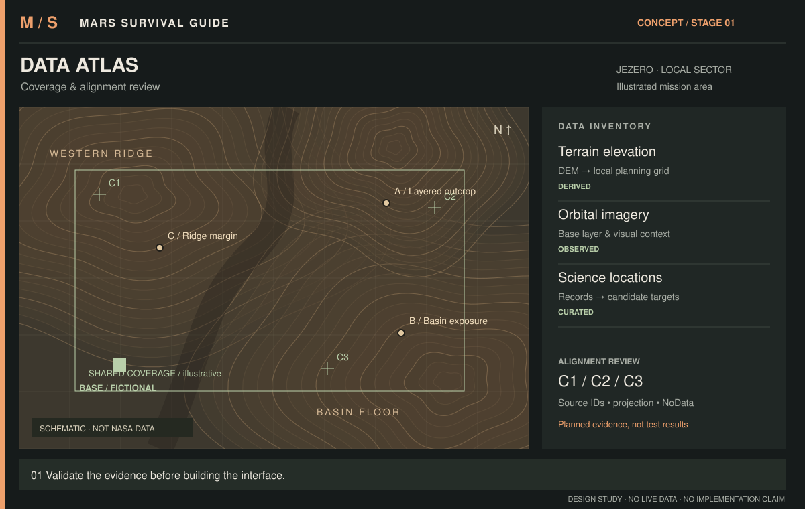
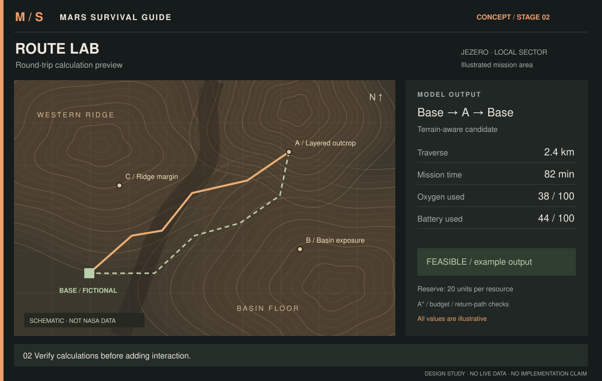
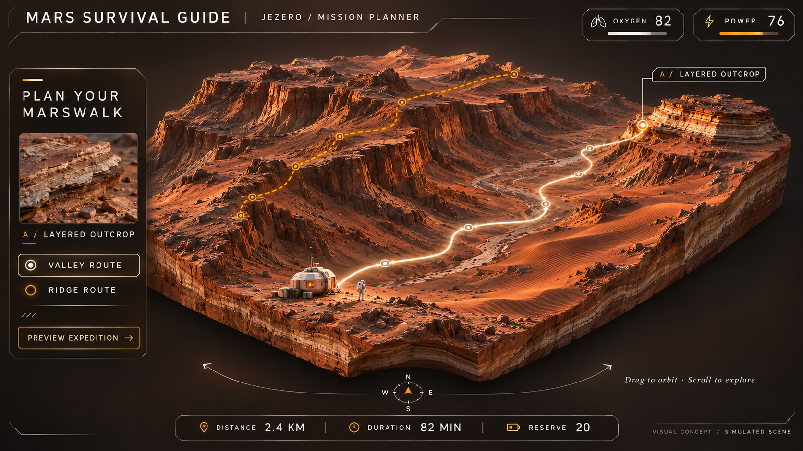
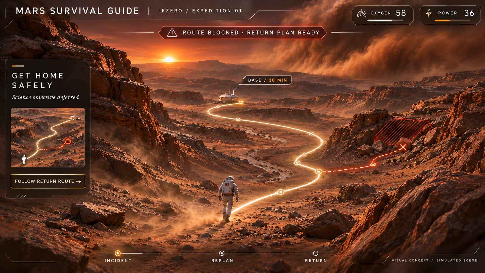
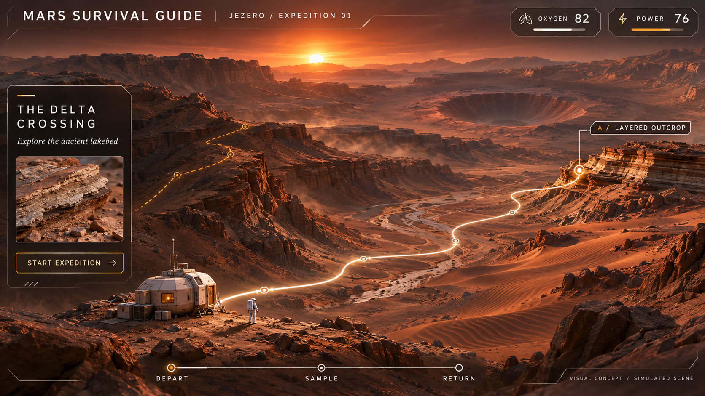

# 实施文档入口

更新：2026-11-15。阶段 1–4 与视觉改版 V1–V4 已有实现和验收记录；阶段 5 的公开部署与参赛提交已完成：英文项目说明、数据引用与 AI 使用披露已整理至 [SUBMISSION.md](SUBMISSION.md)，公开部署与比赛表单状态见实施计划末尾。视频已提供；比赛网站于 2026-11-15 23:49（Singapore）显示已提交评审。视频约 35 秒，超过 30 秒要求，全球奖项资格不作保证。

目标是让后续 AI 代理依据同一套约定，分阶段实现 Mars Survival Guide。本文档定义开发基线，阶段状态不代表超出该阶段范围的功能已完成，也不自动启动开发、发布或比赛提交。

## 先看效果

以下展示五个阶段的效果图。阶段 1–2 保留数据与计算验证示意，阶段 3–5 采用新的电影感探索沙盘视觉。这些是设计示意，使用自绘或 AI 生成地形、虚构地点与示例数值，不是真实数据或已实现功能。详细验收要求见[实施计划](IMPLEMENTATION.md)，新的美术与动效方向见[视觉约定](VISUAL-DIRECTION.md)。生成图中的地形、岩层和沙尘是美术表达，不是地质重建或气象预测；静态图也不代表已交付模型或动效。

### 阶段 1：数据与场景

看清地形、科学地点和共同覆盖范围，核对来源与空间对齐。此时交付数据图册，还没有路线规划或任务模拟。



上图为设计示意。阶段 1 的实际交付是对齐检查图与真实数据包：`public/data/jezero/alignment/alignment_check.png`（真实 CTX 地形+影像叠加、控制点与模拟场景锚点）及 `public/data/jezero/` 下的区域/地形/地点/场景/来源清单。

### 阶段 2：路线与预算

查看去程、停留、返程及资源预算的计算结果，验证可行、超预算与不可达情况。此时交付计算内核，尚无完整产品交互。



上图为设计示意。阶段 2 的实际交付是 TypeScript 计算内核：`npm run demo`（命令行打印真实区域三个地点的往返计划）、`npm run dev`（最小开发页表格输出）与 28 项自动化测试；结果数值均来自真实地形网格与已标注的模拟假设。

### 阶段 3：规划控制台

旋转立体地形沙盘、选择科学目标，在谷底与山脊路线之间查看取舍。此时可以规划任务，还不能播放任务或触发应急事件。



上图为美术概念稿。阶段 3 的实际交付是可运行控制台：`npm run dev` 后即可旋转真实 Jezero 地形沙盘、选点触发镜头过渡、查看贴地路线与预算面板（运行命令与验收证据见[实施计划](IMPLEMENTATION.md)第 11 节）。

### 阶段 4：模拟与应急

跟随宇航员体验任务，用视角转场、封路标记与返航路线展开表现突发事件。无法满足返航条件时，明确显示失败原因。



上图为美术概念稿。阶段 4 的实际交付已可运行：`npm run dev` 后选择 SCENARIOS 中的脚本化场景（名义往返 / 采样中封路绕行 / 电池预留击穿 / 电池滞留）并 START EXPEDITION，即可观看宇航员沿真实路线行进、事件触发、应急返航重算与完成/失败结局（全部为确定性模拟重放，证据见[实施计划](IMPLEMENTATION.md)第 11 节）。

### 阶段 5：最终交付

将完整任务体验、来源说明和演示材料整理成可公开体验的参赛版本。部署与比赛提交状态分别核实，不增加尚未约定的功能。



## 阅读顺序

1. [调研与证据边界](RESEARCH.md)：比赛要求、数据候选、原始设想问题、待验证事项。
2. [产品与工程约定](SPECIFICATION.md)：范围、技术选择、接口、计算规则和交互状态。
3. [阶段实施与验收](IMPLEMENTATION.md)：阶段依赖、交付物、验收条件及代理执行方式。
4. [3D 视觉升级方案](VISUAL-UPGRADE-PLAN.md)：演示视频导向的地形/光照/镜头/第一人称改造，含方向原型与诚实边界待决项。

## 实施路线

```text
阶段 1：验证数据并冻结场景
    ↓
阶段 2：建立可测试的路线与资源模型
    ↓
阶段 3：交付可交互的地图规划控制台
    ↓
阶段 4：贯通任务模拟与应急返航
    ↓
视觉改版 V1–V4：3D 地形为中心的布局、可拖动任务时间轴、
                可返航范围边界、方案对比呈现（见 IMPLEMENTATION.md §7）
    ↓
阶段 5：完成参赛版本、公开验证和提交材料

后续扩展：高级地形美术、多目标规划、环境与辐射模型、AI 助手
```

前五阶段构成参赛核心版本。扩展单独安排、单独验收；时间或数据不允许时保留为后续工作，不包装成已有功能。

## 文档维护约定

- 研究事实与来源在 `RESEARCH.md` 维护；接口与算法在 `SPECIFICATION.md` 维护；阶段状态在 `IMPLEMENTATION.md` 维护，避免多份状态表互相冲突。
- 状态词：`未开始 / 进行中 / 待验收 / 已验收 / 受阻`。测试通过不等于用户已验收。
- 每阶段开工重读工作区与文档。若数据推翻假设，先修订受影响约定，说明影响，再继续依赖它的工作。
- 当前阶段完成后交付结果与证据，等待下一阶段安排；阶段内部不为普通实现细节反复询问。
- 文档中的未来目录、接口、命令和性能指标是开发要求，不是现有实现或实测结果。
