# 3D 视觉升级方案（演示视频导向）

更新：2026-11-15。本文只回答一个问题：**在不牺牲"真实数据 / 模拟数据"边界的前提下，怎样让沙盘在演示视频里第一眼抓人。** 方案中的参数与机位来自本机实测与 [lookdev 原型](../lookdev.html)，不代表已经改进主应用。

对照图：

| 现状 | 方向验证（lookdev） |
| --- | --- |
| 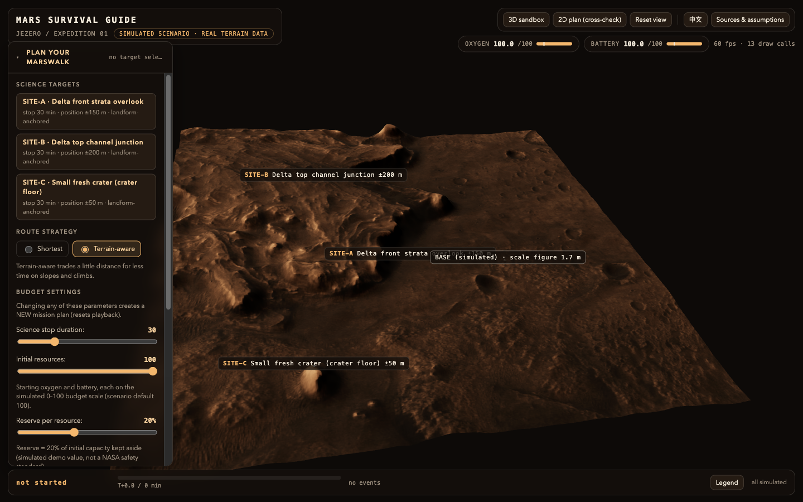 | 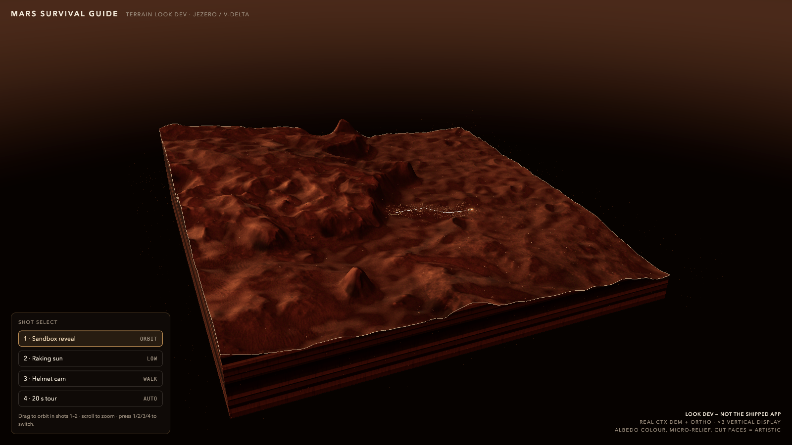 |
| 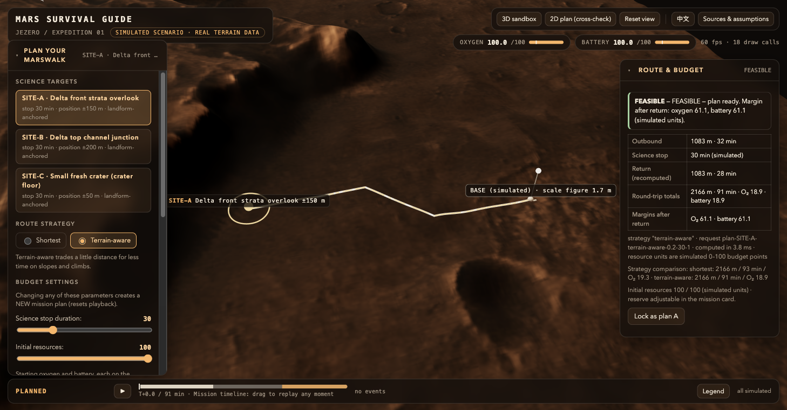 | 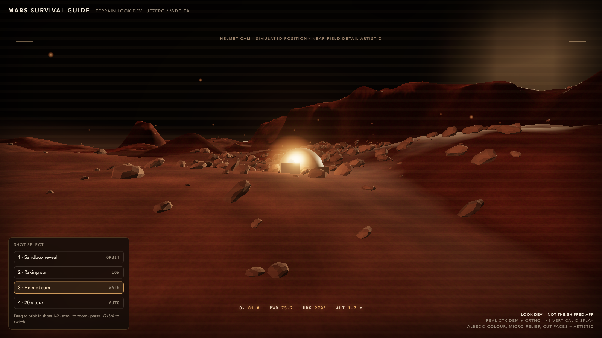 |

## 0. 实施进度

**2026-11-15：第一批已交付并验证。**

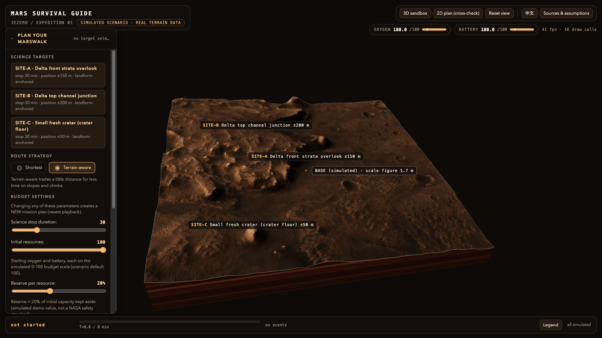

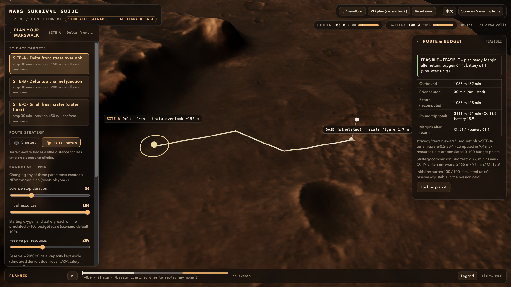

- 剖切块体：[`src/ui/BlockSides.tsx`](../src/ui/BlockSides.tsx)。侧壁、层理、切深、压边光、底座；顶边几何锚点取自真实 DEM 边缘，层理为美术表达。
- 取景：`overviewPose` 拉到 7200，让块体厚度（侧壁 + 底座）进入画面。**选点后的镜头按用户要求保持贴近**：`routePose` 仍是 3.3 × 路线半径、45° 俯角、目标为路线包围盒中心——路线占满画面，不改成"整块在画"的大远景；块体改由总览与低机位镜头承担。
- 标签：新增 [`src/ui/LabelLayout.tsx`](../src/ui/LabelLayout.tsx)，屏幕空间避让（先上下位移、再隐藏），并把**计划路线**当作障碍物；有方案时只保留选中站点与基地标签，基地标签右移。
- 顺手修掉的两个真问题：① 相机 `near` 从 1 改为 50 —— 6 km 处深度精度不足，贴地 4.5 单位的路线会被地形遮住；② 图例里重复的「selection ring」条目。
- 标注与文档：图例新增剖切块条目；「来源与假设」新增「显示美术（非数据）」小节；`VISUAL-DIRECTION.md` 落定为方案 C（3D 美术化 + 2D 保持数据真相）。
- 验收：draw calls 16（无方案）/ 23（有方案）；`tsc --noEmit`、`npm run build` 通过；58 项功能测试通过。唯一例外是 `tests/field.test.ts` 的 50 ms 性能门禁——本机当时负载 ~7（同时跑浏览器与开发服务器），该项实测 100–315 ms 抖动；该代码路径（`src/routing/`、`src/simulation/`）本批未改动，空闲机器上需复测。

**2026-11-15：第二批已交付并验证。**

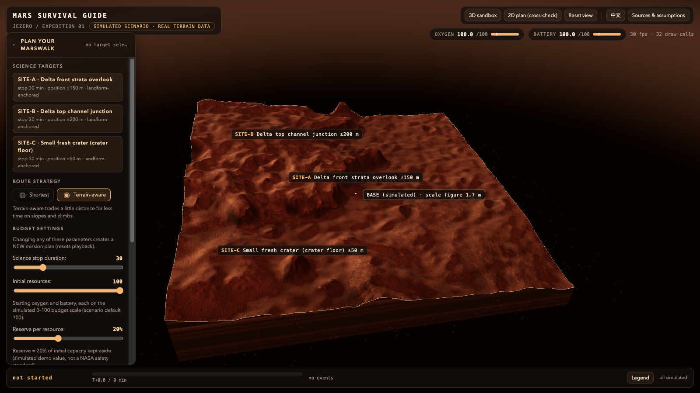

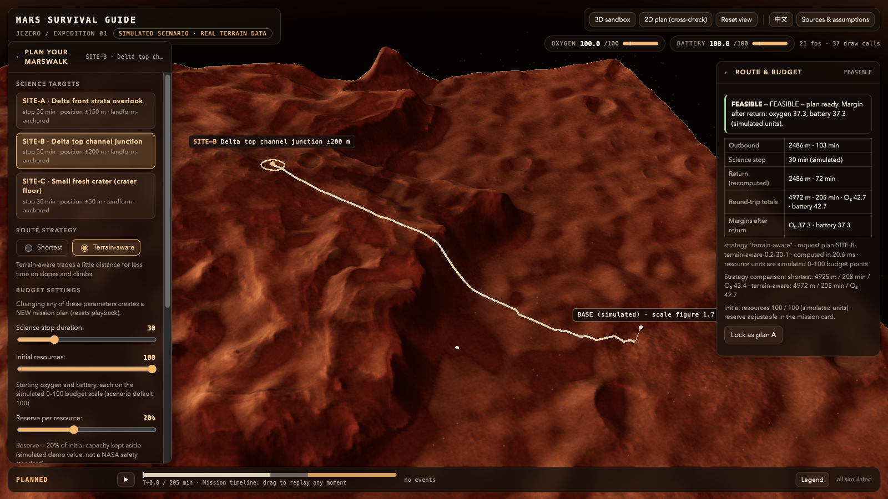

第一批 → 第二批对照：

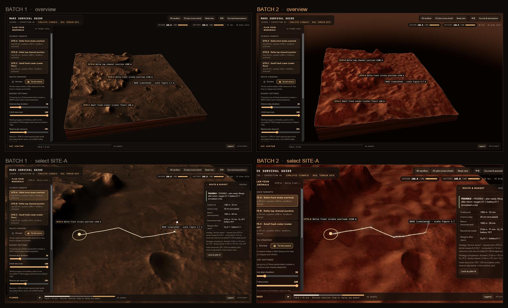

- 显示地表：[`src/ui/terrainLook.ts`](../src/ui/terrainLook.ts)。真实正射亮度 × 坡度/曲率配色 × DEM horizon-scan 长阴影（15° 西北向，与主光一致），加局部对比与微观起伏法线；加载期一次性烘焙（0.6–0.9 s，分片让出主线程）。
- 场景：[`src/ui/SceneDressing.tsx`](../src/ui/SceneDressing.tsx)。天空渐变 + 低空雾、漂浮尘粒、ACES 色调映射、泛光链（`?post=force` / `?post=off` 可强制开关；默认自适应：首 1.6 s 平均帧时间 > 33 ms 就自动关闭）。
- 材质：地表在近距离加了一层米级颗粒（世界坐标噪声），避免 5 m/px 正射被放大成糊；顶点/法线细节仍在数据层之外。
- 显示比例：`RELIEF_SCALE` 3 → 4.5（图例与文档同步改为 "vertical relief ×4.5 display only"）。
- 调试开关：`?raw` 用原生正射渲染，`?nofield` 关闭回航范围染色，`?post=force|off` 强制开关泛光。
- 修正（同日）：回航范围原先用 6 万多个 20 m 贴地小方块铺在地表上，在 ×4.5 起伏下与地形互相穿插，看起来像一层网格/锯齿。现改为把"步行分钟"烘成一张 256² 纹理，由地表材质按 UV 直接染色并画出等值线（[`src/ui/fieldMask.ts`](../src/ui/fieldMask.ts)），既贴地形、又不会深度打架；顺带把每次拖动时间轴都要重建 6.5 万格的几何去掉了，该状态下帧率从 18–29 fps 回到 43 fps。

**2026-11-15：第三批已交付并验证。**

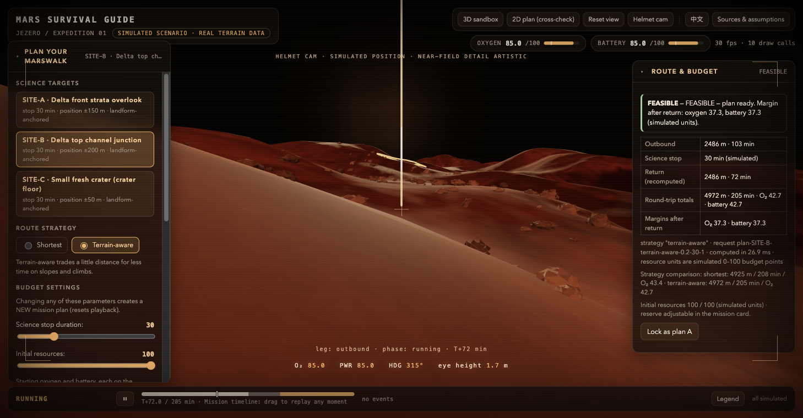

- 头盔视角：[`src/ui/HelmetCam.tsx`](../src/ui/HelmetCam.tsx) + [`src/ui/HelmetHud.tsx`](../src/ui/HelmetHud.tsx)。相机读运行时的插值位置与行进方位（`HudMirror.headingRad`，由 T 与 T+0.6 min 的状态差推导），眼高 3.6 单位、fov 68、近裁面 1.2；进入时保存并关闭 OrbitControls，退出还原。拖时间轴视角同步，暂停即停，站定时保留上一个方位。
- HUD：O₂ / PWR / 航段 / 状态 / T+ / 方位 / 视高，全部来自运行时；角落常驻 "HELMET CAM · SIMULATED POSITION · NEAR-FIELD DETAIL ARTISTIC"。2D 视图或任务未开始时按钮禁用。
- 近景：实例化岩块 900 个（路径 16 单位内不落石，避免糊住镜头）、基地信标呼吸环、路线上的移动光点、事件红脉冲。
- 标注：图例与「来源与假设」把岩块与辉光一并列入"显示美术"。

**2026-11-15：第四批已交付并验证（地表回归卫星影像）。**

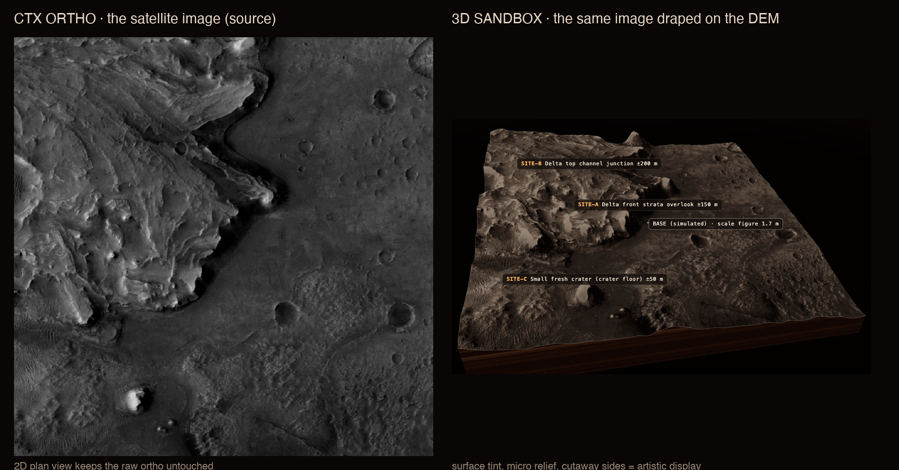

第二批的调色把坡度/曲率变成大面积色块、再叠一层烘焙长阴影和强主光，结果是"3D 场景自己画自己的"：地形轮廓还在，但已经看不出是同一张 CTX 影像。第四批把主导权交回影像本身：

- 反照率（[`src/ui/terrainLook.ts`](../src/ui/terrainLook.ts)）：以正射灰度作为**唯一的明暗与结构来源**，只做温和的区间拉伸和一条近中性的暖灰渐变色带；坡度/曲率仅以 6%–10% 的幅度提示岩性，烘焙长阴影降到 0.10 的乘子（影像是太阳照射下的真实辐亮度，再压一遍就变成"二次打光"）。近场颗粒与微观起伏同样减半。
- 光照（[`src/ui/Sandbox.tsx`](../src/ui/Sandbox.tsx)）：主光 2.8 → 0.45、半球光与环境光提高到承担基础照明、补光暖度降低；曝光 1.15 → 1.12，雾改中性偏冷棕。因此画面由影像的明暗决定，灯光只补立体感。
- 材质/后处理：法线强度 1 → 0.6，泛光强度 0.34 → 0.22、阈值 0.95；剖切侧壁的层理降饱和，避免底下一条亮橙色把中性的顶面拉回"火星主题公园"。
- 结果：卫星图上的三角洲前缘、河道、陨石坑与小沙纹在 3D 里可逐一对上，整体色调接近 NASA 发布的火星轨道影像；2D 校验视图仍绘制未经处理的灰度正射。

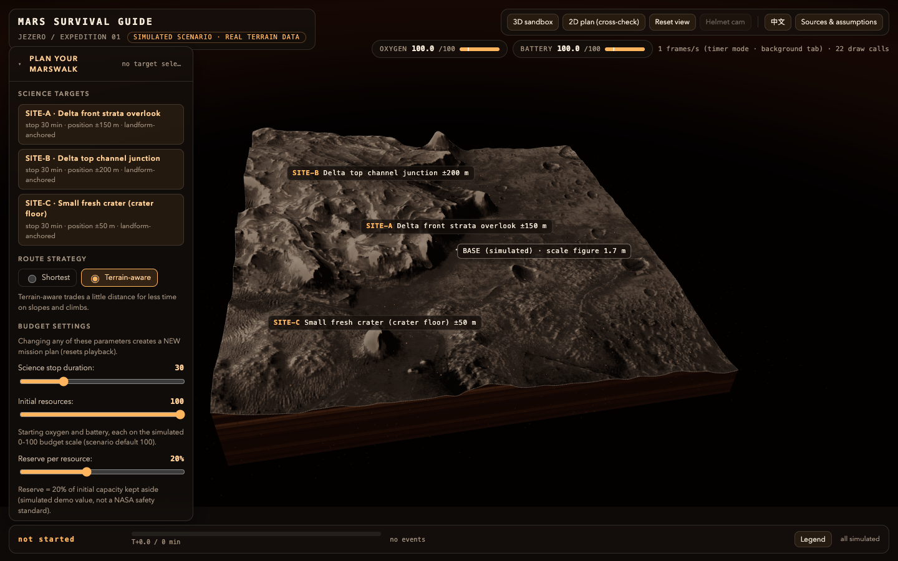

**2026-11-15：第五批已交付并验证（从火星俯冲进入）。**

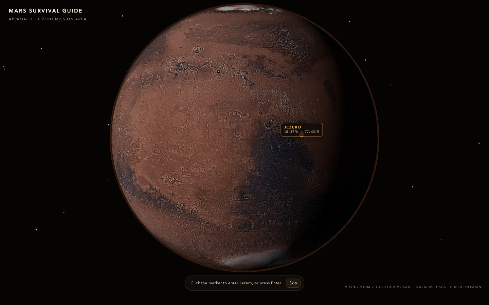

用户要的"从火星开始 zoom in"落成开场两段式，而不是每次选点都拉远：

- 星球是真的：Viking MDIM 2.1 全球彩色镶嵌（NASA/JPL/USGS，公有领域；来源、处理与许可见 [`public/data/mars/README.md`](../public/data/mars/README.md)），2048×1024 随包发布，不联网。Jezero 标记直接用 `region.json` 的 `boundsLatLon` 计算，不是手摆的。
- 交互：点标记（或按 Enter）后，相机沿该点法线俯冲 2.3 s；最后 0.6 s 叠层溶解。地形相机在溶解开始前已经预置到低空落脚位（`y=4200, z=2100`，目标三角洲中心），所以露出的就是俯冲方向上的近景，随后 3.2 s 拉回总览。Skip / Esc 可跳过。
- 开关：`prefers-reduced-motion` 直接进入并瞬移；`?intro=off` 关闭开场；`?intro=auto` 自动俯冲（录屏用）；顶栏新增「From Mars / 从火星看」可随时重播。
- 边界：球体只做定位语境，不参与任何计算；标记数值来自数据包；2D 视图不出现球体。

## 1. 先看结论

现在的问题不是"模型太简单"，而是**三件事同时发生**：地形只有一张均匀褐色的贴图、没有明暗层次、镜头又贴得太近。结果是一块"糊掉的棕地图"，观众无法判断自己在看什么尺度。

按投入产出排序，最该先做的是：

1. **把地板变成标本块**（剖切侧壁 + 层理 + 压边光）——半天，收益最大，一眼就是"3D 模型"。
2. **光照与材质重做**（DEM 烘焙长阴影、调色、雾、泛光）——1–2 天，决定"高级感"。
3. **改镜头语言**（选点后不要贴脸；固定三个机位 + 90 秒分镜）——半天，直接决定视频观感。
4. **第一人称 / 头盔视角**（沿真实路径行走 + 极简 HUD）——2–3 天，是评委记得住的那一个镜头。
5. **动态细节**（路线能量流、基地信标、采样扫描、尘、事件脉冲）——1–2 天，把静态图变成"活的"。

## 2. 现状诊断（都有依据）

| 事实 | 依据 | 视觉后果 |
| --- | --- | --- |
| 地形网格 256×256、20 m 格、5.12 km 见方，起伏仅 210 m（−2610.9 ~ −2400.9 m） | `terrain.json` stats | 真实起伏只占宽度的 4%；即使 ×3 垂直夸张，仍偏平 |
| 正射影像 **1024² 单通道灰度**，5 m/px，靠 material `color="#e2a877"` 上色 | `ortho_5m.jpg`（L 模式）、`Sandbox.tsx:119` | 全场一个褐色，没有岩性、沙丘、月牙形沙纹的色差 |
| 只有 1 个主方向光 + 1 个补光 + 半球光；无阴影、无雾、无后处理 | `Sandbox.tsx:674–680` | 没有长投影和空气感，远山与近景糊成一片 |
| 选点后的取景用 `routePose`：距离 = 3.3 × 路线包围半径、45° 仰角 | `world.ts`（第一批已改） | 镜头落到 3.5 km 处正对 5 km 见方的贴图，画面被"糊地图"填满，块体边缘看不见 |
| 站点标签是固定屏幕尺寸的 HTML，不做避让 | `Sandbox.tsx:330`、`MissionLayer` | 选中 SITE-A 时与 BASE 标签重叠 |
| 路线是 3.5 px / 2.5 px 的线，展开动画 1.1 s | `Sandbox.tsx:219–235` | 细、暗、没有"能量"感，远看几乎消失 |
| 实测 13–18 draw calls、60–120 fps（M4，1440×900） | 界角读数 + 本次实测截图 | 还有很大预算：阴影、泛光、粒子都加得起 |

结论：**数据分辨率和起伏先天有限，必须靠"显示层的照明 + 材质 + 构图"补足，而不是继续加几何细节。**

## 3. 方案总表

| 优先级 | 改动 | 收益 | 成本 | 风险 |
| --- | --- | --- | --- | --- |
| P0-1 | 剖切块体（侧壁层理 + 顶部压边 + 底座） | 立刻从"地图"变"模型"；与概念稿 stage-03 一致 | 0.5 天 | 低（纯显示几何） |
| P0-2 | DEM 烘焙长阴影 + 调色 + 法线细节 + 雾 + ACES/泛光 | 决定"高级感" | 1.5 天 | 中（需处理"艺术化"标注） |
| P0-3 | 镜头语言：取景保持整块在画 + 三个固定机位 | 直接决定视频观感 | 0.5 天 | 低 |
| P1-1 | 头盔 / 第一人称视角（沿真实路径、极简 HUD） | 最容易被记住的镜头 | 2–3 天 | 中（近场地形精度不足，需细节层） |
| P1-2 | 动态细节（能量流、信标、扫描环、尘、事件脉冲） | 把静态图变成现场 | 1–2 天 | 低 |
| P2 | 演示包装（录制规格、字幕、分镜重拍） | 成片稳定 | 0.5 天 | 低 |

## 4. P0-1 把地板变成标本块

做法（`src/ui/Sandbox.tsx` 新增 `BlockSides`，几何来自同一份 DEM 边缘）：

- 沿区域四条边，把边缘顶点向下挤出到 `最低点 − 300`（世界单位），形成侧壁；底面一块暗色平面封口。
- 侧壁贴一张**竖向层理纹理**（canvas 程序生成，64×1024，可平铺），UV 的 v 用世界高度比例，u 用周长/260 m。层理是美术表达，不是地层重建。
- 沿顶边加一条 1 px 压边线（`#ffcfa2`，透明度 0.35），让"切面"在黑色背景上有轮廓。
- 侧壁朝向镜头的一侧需要一盏低强度补光（`#ff9d63`，0.7–1.0），否则切面全黑。

验收：总览截图里能同时看到**顶面、两条侧壁、暗色底座**，块体四边都在画面内并留暗边。

## 5. P0-2 光照与材质

### 5.1 用 DEM 烘长阴影，而不是 shadow map

20 m 格网 + 5 km 尺度下，阴影贴图要么糊要么有锯齿；直接在地理网格上做 horizon scan，在纹理里烘死，**零运行时开销、阴影形状是真实地形**：

- 太阳高度 16–18°，方位西北（与现有 DEM 山影约定一致）。
- 每个 20 m 格向太阳方向步进（80 m/步、40 步），记录最大仰角；超过太阳高度即判为阴影。
- 结果作为乘子写入反照率纹理（强度 0.3–0.45，外加一层方向光），既能保住明暗，又不会把画面压黑。

### 5.2 反照率：影像第一，调色第二（第四批已按此重做）

- 以 1024² 正射灰度作为**明暗、结构与细节的唯一来源**：轻微反锐化恢复脊线，再把偏暗的灰度区间（均值 ≈ 0.23）温和拉伸到屏幕可读的范围。
- 颜色只做一条近中性的暖灰渐变色带（暗玄武岩 → 暖尘 → 浅色脊线），不按坡度大面积换色；坡度/曲率只以 6%–10% 的幅度增减亮度，读起来是"同一张照片的立体版"，而不是"给地形重新上色"。
- 长阴影在 0.10 的乘子下只做深度线索：CTX 正射本身已经记录了真实日照，再叠一层投影会变成二次打光，这正是第二批"自己画自己"的主因。
- 近场 1–3 m 颗粒保留但幅度减半，避免把 5 m/px 的影像变成噪声。

### 5.3 后处理与天空

- `ACESFilmicToneMapping`、曝光 1.1–1.2；`UnrealBloomPass` strength 0.3–0.45、radius 0.5、threshold 0.85（只让路线、信标、太阳发光，地面不发光）。
- 天空球：天顶近黑（0.006）、地平线暖棕（0.085），太阳方向一束收紧的暖光；`FogExp2` 密度 3–5e-5 让远山退远。

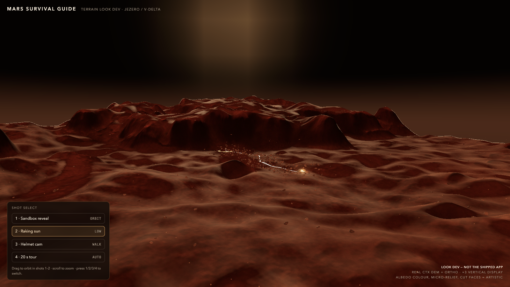
- 保留西北主光，补光改暖（`#ff9d63`）并压低，避免切面死黑或过曝。

### 5.4 垂直夸张要重新标定（已实施：×4.5）

真实起伏 210 m / 5.12 km。当前 `RELIEF_SCALE = 3`，总览仍偏平；lookdev 里 **×4.5** 的块体明显更像"峡谷模型"。建议：

- 已定案：`RELIEF_SCALE = 4.5`，图例与 `SPECIFICATION`/`IMPLEMENTATION` 同步改为 "vertical relief ×4.5 display only"。
- 这是**一个常量 + 一句图例**的改动，路线、标记、剖面会跟着一起缩放（都走 `worldY`），不会错位。

## 6. P0-3 镜头语言

现在的两段飞行（`sitePose` → `routePose`）逻辑没问题，问题在参数：落点太近、仰角太高、目标点太低。

| 机位 | 用途 | 位置建议（世界坐标量级） | 参数 |
| --- | --- | --- | --- |
| A 总览 | 开场、结尾、"整块在画" | 距中心 ≈ 7–8 km，方位东南 | fov 38–40，仰角 24–28°，目标 y ≈ 中心 +100 |
| B 掠射逆光 | 情绪镜头、路线展开 | 贴块体一侧，仰角 8–12°，望向太阳 | fov 40–45，目标抬到山脊线 |
| C 头盔 | 行走 | 真实路径点 +2.5 m | fov 62–68，视线前倾 3–5° |
| D（可选）低空掠过 | 转场 | 距地 60–120 m 沿谷底 | fov 45，2–3 s 直飞 |

`routePose`：**保持现状**（3.3 × radius、45°、目标 = 路线中心）——用户明确要求选点后画面要大、路线要占满，块体边缘留给总览镜头。（曾试过 2.4–2.6 × radius 的远景方案，观感不如下，已回退。）

另外：站点标签加**碰撞避让**（同屏最多 3 个，选中项优先），或者只显示选中项 + 悬停项。

## 7. P1-1 第一人称 / 头盔视角

### 7.1 先说实话：20 m 格网的近景撑不住

站在 1.7 m 眼高时，最近的三角形有 20 m 宽，5 m 外的一条边就有 76° 张角——**纯 DEM 渲染会看到巨大的三角面**。lookdev 里那个"熔蜡"般的近景就是这个原因。所以第一人称必须配三件东西：

1. **近场细节层**（shader 里加 1–3 m 颗粒 + 法线扰动），成本几乎为零；
2. **实例化岩石场**（一次 draw call，1800 块，路线上 70%、全域 30%，尺寸 1.2–12 m），负责尺度感与前景遮挡；
3. **雾 + 尘**，把 200 m 外的模糊藏起来。

### 7.2 这个模式必须"诚实"

- 相机位置只来自已有的确定性运行时（`hudRef.astronaut`，`src/simulation/runtime.ts`），拖动时间轴时视角跟着回放——不解算、不插值造假。
- 抬头显示只放真实数值：O₂ / PWR（模拟刻度）、HDG（由路径切线算）、ALT（真实地形高差）。
- 画面角落固定一行 "HELMET CAM · SIMULATED POSITION · NEAR-FIELD DETAIL ARTISTIC"。

### 7.3 交互与节奏

- 进入：0.8 s 视线下沉 + fov 收窄；退出：0.8 s 抬起回总览（`prefers-reduced-motion` 直接切）。
- 行走：速度取模拟时钟（40 m/min ≈ 0.67 m/s）；演示视频用 ×8 速度，镜头呼吸与步频由同一时钟驱动，避免"飘"。
- 允许鼠标自由环视（±120° 偏航、±35° 俯仰），松手 2 s 后缓缓回正到前进方向。
- HUD：四角取景框、准星、O₂/PWR 条、航向刻度、轻微扫描线与暗角（CSS 叠加即可，不进 WebGL）。

## 8. P1-2 动态细节清单

| 元素 | 做法 | 备注 |
| --- | --- | --- |
| 路线能量流 | 现有 `Line2` 换成贴地光带（宽 10 m，加色混合 + 中心高光），沿 UV 流动 | lookdev 已实现，见 `buildRouteRibbon` |
| 路线展开 | 保留现有 1.1 s instanceCount 动画，加一个移动光点引导 | 不加假路径 |
| 基地信标 | 呼吸光 + 顶部小灯 + 3 s 周期扫描扇面 | 模拟设施，画面上标 simulated |
| 采样扫描 | 抵达科学点时地面琥珀圆环扩散 2 次 + 卡片弹出 | 与停留时长联动 |
| 事件脉冲 | 电池损失：屏幕边缘红色径向脉冲 300 ms；封路：矩形描边闪烁 2 次 | 不做全屏红闪 |
| 尘 / 空气 | 1–2 层水平雾片 + 1200 个软粒子慢漂 | 低空才可见 |
| 时间轴 | 播放头加光点，资源数字滚动，边界收缩保留现有 300 ms | 与数值同步，不做粉饰 |

## 9. 90 秒演示分镜

| 时间 | 画面 | 操作 / 状态 | 字幕或口播要点 |
| --- | --- | --- | --- |
| 0:00–0:06 | 黑场→块体从上方压入，压边光扫过一次 | 刷新页面，让开场镜头跑 | 这是真实 CTX 地形，5 km 见方 |
| 0:06–0:16 | 掠射逆光，路线从基地展开 | 选中 SITE-A | 20 m 规划格、210 m 起伏，垂直 ×4.5 仅显示 |
| 0:16–0:26 | 总览保持整块在画，A/B 双线 | 切换策略 | 两条候选，取舍来自坡度与爬升代价 |
| 0:26–0:36 | 启动远征 ×8，时间轴推进，返航边界收缩 | START EXPEDITION | 边界 = 此刻还能走回基地的范围 |
| 0:36–0:46 | 电池损失，旧线变灰、应急琥珀线展开 | 点事件 | 重规划从精确位置开始 |
| 0:46–1:00 | 切头盔视角，沿路线前进 10 s | 按键/按钮进入 | 位置来自同一次模拟，不是动画 |
| 1:00–1:10 | 抵点，扫描环 + 科学卡片 | 停留 30 min | 停留时长可调，预算实时重算 |
| 1:10–1:20 | 拉回总览 + 方案 A/B 对比 | 锁定 A | 逐项差值 |
| 1:20–1:30 | 结尾：品牌 + "SIMULATED SCENARIO · REAL TERRAIN DATA" | — | 数据来源与假设抽屉 |

录制参数：1600×900（或 2560×1440 再缩到 1080p）、60 fps、隐藏鼠标、先跑一遍预热（避免首帧着色器编译卡顿）。

## 10. 需要你拍板的一处：诚实边界

`docs/VISUAL-DIRECTION.md` 明确写了 **"不加虚构岩石细节贴图（会混淆 observed/simulated 数据边界）"**。上面 P0-2 的调色、近场颗粒、岩石实例，都属于这条线以内/边缘的改动。三种选择：

- **A（推荐）**：3D 显示层允许"艺术化外观"（调色、近场颗粒、岩石实例、层理），但必须做到：不进入任何计算；图例与"来源与假设"抽屉新增一条 "surface colour / micro-detail: artistic display"；2D 校验视图保持原生正射灰度，作为"数据真相"视图。
- **B**：只做中性增强（光照、雾、剖切几何、ACES/泛光），不加颜色与岩石。
- **C**：A 用于 3D 演示，B 用于 2D 校验与截图证据（折中）。

选 A/C 的话，需要同步改 `VISUAL-DIRECTION.md` 的那一条，否则文档与实现会互相矛盾。

## 11. 落地顺序与验收

**第 1 天**：P0-1 剖切块 + P0-3 取景参数 + 标签避让。
验收：总览截图四边可见、无标签重叠；选点后路线满画且块体边缘仍在画面内。

**第 2–3 天**：P0-2 烘焙纹理管线（建议做成构建期产物：`scripts/` 里生成 `public/data/jezero/visual/albedo.png` + `normal.png`，写进 `checksums.json`，标注 derived + artistic），加雾、泛光、天空。
验收：首屏仍然 ≤ 2.5 s 可交互；帧率 ≥ 50 fps；2D 视图不变。

**第 4–6 天**：P1-1 头盔视角 + HUD；P1-2 动态细节。
验收：拖时间轴时视角同步；`prefers-reduced-motion` 有静态替代；HUD 数值全部来自运行时。

**第 7 天**：按第 9 节分镜录 90 秒。

## 12. 方向原型怎么跑

```bash
npm run dev
# 浏览器打开 http://localhost:5173/lookdev.html
# 可选：?v=4.5 提高垂直夸张（默认 3，与主应用一致）
# 数字键 1/2/3/4 切换机位：块体总览 / 掠射逆光 / 头盔视角 / 20 秒循环
```

原型用同一份 `public/data/jezero` 数据和同一条路线内核（`planRoundTrip`）渲染；它的目的是让方向可以被看到和被否掉，**不是主应用的实现**，也没有做性能与降级处理。
